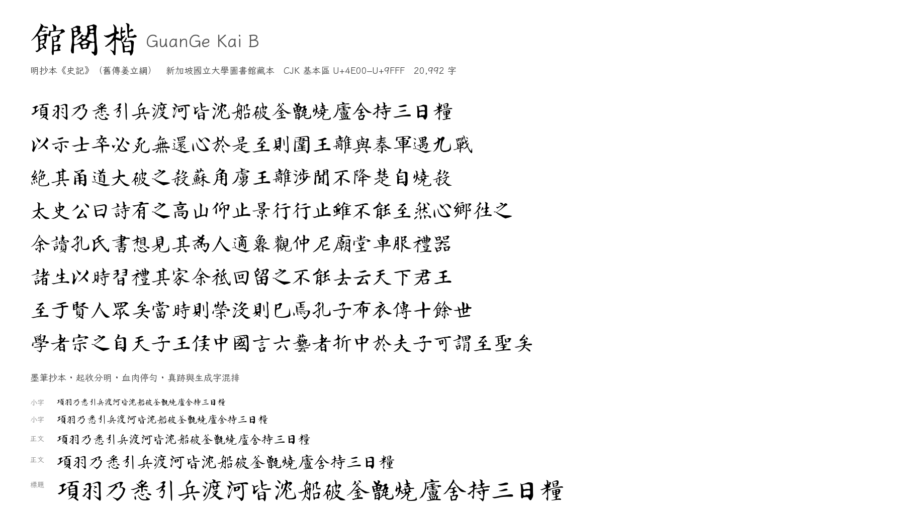
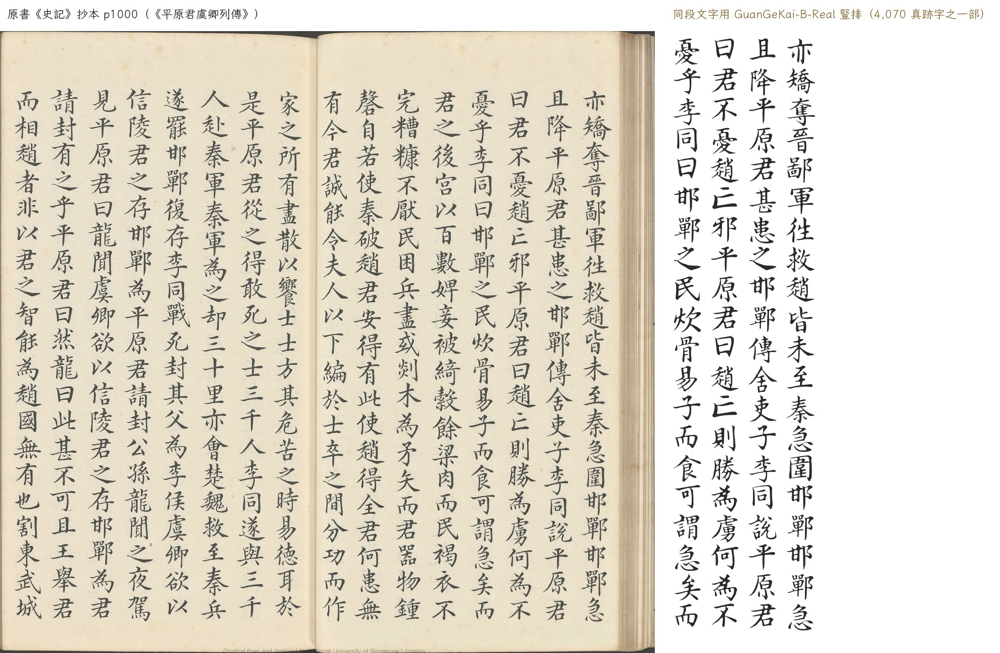

# 館閣楷 B　GuanGe Kai B

> 從明抄本《史記》（舊傳姜立綱）整理的一套館閣體開源字型，覆蓋 CJK 基本區
> U+4E00–U+9FFF 全部 20,992 字，SIL OFL 1.1 授權。
>
> **這是第二套（B 線）。** 第一套（A 線，家族名 `GuanGe Kai`）的字形來自明刻本
> 《四書白文》，兩套字形的**來源不同**，可以同機安裝、分別選用。

<p align="center">
  
</p>

---

## 1. 這是什麼

**版本**：本包为 **GuanGe Kai B v1.1.0**，随主版本 **GuanGeKai v1.6.3** 一起发布
（同一项目、两个字形来源：A = 四书刻本 `GuanGe Kai`，B = 史记抄本 `GuanGe Kai B`，
两套家族名并存，互不覆盖）。

- `GuanGeKai-B-Regular.ttf`：完整字集 **20,992 字**（CJK 基本區 100%）＝ 真跡 4,073 + 生成 16,919；
  字型內另有 5 個擴展 A 的真跡字，故 `cmap` 實際 20,997 個碼位
- `GuanGeKai-B-Real.ttf`：只有 4,078 個真跡字，全部逐字從掃描本切出、向量化

真跡字的字形**直接來自抄本**：切字、去噪、potrace 向量化，再歸一到統一字身框。
生成字由 GAN（zi2zi U-Net + PatchGAN）以霞鶩文楷為骨架、以抄本筆形為風格生成；
守衛不通過的字改用「帶狀掃掠」描繪。逐字來源見 `provenance.json`
（`real` / `gan` / `ribbon_fb`）。

| 項 | 值 |
|---|---|
| 家族名 | `GuanGe Kai B` |
| PostScript 名 | `GuanGeKaiB-Regular`、`GuanGeKaiB-Real` |
| UPM | 1000（ASC 880 / DESC −120，字面框 0–880） |
| 格式 | TrueType（TTF/glyf），無 hinting |
| 授權 | [SIL Open Font License 1.1](OFL.txt) |

## 1.5 眼見為實：原書與字型對照

左邊是抄本原頁（《平原君虞卿列傳》），右邊是同一段文字用本字型的真跡字豎排。
可以看到起收筆、轉折與字距的來源：

<p align="center">
  
</p>

## 2. 與《四書》版的分工

| | A 線 `GuanGe Kai` | **B 線 `GuanGe Kai B`** |
|---|---|---|
| 字形來源 | 明刻本《四書白文》（舊傳姜立綱） | **明抄本《史記》（舊傳姜立綱）** |
| 載體 | 刀刻刻本 | **墨筆抄本** |
| 掃描原生解析度 | 300 dpi | **150 dpi** |
| 真跡字數 | 1,675（8.0%） | **4,078（19.4%）** |
| 真跡／生成 | 1,675 / 19,317 | **4,078 / 16,919** |

兩套字的筆性不同：刻本有刀口的方折與飛白，抄本有墨筆的起收與牽絲。**不要混用**，
排版時整段選用同一套。若系統裡同時安裝，字型選單會顯示為兩個家族。

## 3. 數據來源

- **原書**：明抄本《史記》二十四冊，新加坡國立大學圖書館藏（`RARE BOOK R 6427`）。
- **數字化**：NUS Libraries。影像頁腳的 `Original from and digitized by National
  University of Singapore Libraries` 即其來源標識。
- **原書為公有領域**；掃描件是公版二維作品的**忠實再現**，本項目不主張任何權利，
  也不對掃描影像主張權利。詳細論證見 [`docs/DATA-B.md`](docs/DATA-B.md) §3。
- **對齊參考文本**：公有領域《史記》全文（[`docs/DATA-B.md`](docs/DATA-B.md) §4）。
  只取其漢字序列用於 OCR 定位，**不進入字型、不隨包分發**。

## 4. 字形處理鏈

```
PDF（1672 頁，雙頁對開）
  → 糾偏：分葉、扣掉兩葉各自的傾角、逐列拉直、壓平折縫陰影
  → 切字：47.4 萬個字格（300 dpi 渲染，字距 174 px）
  → OCR：PP-OCRv6 逐欄辨識（在糾偏後的圖上，與字格同一坐標系）
  → 標註：OCR 為主，公有領域《史記》對齊作校驗與補漏
  → 選優：每字取穩健 medoid 樣本
  → 真跡：potrace 向量化 → 字身框歸一
  → 生成：GAN（練到 50 輪，5 層 PatchGAN + hinge + 數據增強）補齊缺字
     → 缺字 16,927 個：GAN 出字 15,831 + 守衛回退帶狀掃掠 1,088（6.4%）
  → 合字、質檢、打包
```

糾偏是這一線的核心：兩葉的傾角常常相反（0.2–0.5°），整頁一次旋轉會把書脊附近切歪。
實測列中線殘差從 1.11 px@100dpi 降到 **0.50 px**，傾角從 0.18° 降到 **0.035°**。

## 5. 已知限制

1. **生成字不是真跡。** 16,927 個生成字由模型產生（其中 **1,088 個，即 6.4%**，
   因守衛不通過而走帶狀掃掠回退，集中在筆畫複雜的字），筆形接近但不等同於抄本。
   需要嚴格字形時請用 `GuanGeKai-B-Real.ttf`。
   合成字整體比真跡**重約 12.5%**（墨量比 1.125），小字號差距更小（12px 時 ×1.04）。
2. **抄本用字只覆蓋 4,078 字（19.4%）。** 剩餘 80.6% 是合成的；這是本項目最大的
   質量瓶頸，也是 B 線比 A 線好的地方（A 線只有 8.0%）。
3. **沒有 hinting。** 小字號依賴系統自動微調。
4. 抄本與通行本有**脫字、衍字、異體字**差異；標註以「抄本實際寫的字」為準
   （例如抄本寫 `閒`、`爲`、`衆`），不強行改成通行本用字。因此某些常見字
   （如 `眾`、`爲`）在真跡集裡可能不在你最常用的那個碼位上。
5. 極少數頁面（各冊首尾、書名頁、圖書館藏書票、以及十篇「表」的表格頁）不參與
   真跡字表；這些頁的內容無法用正文對齊驗證。

## 6. 授權與命名

- 字型本體：**SIL Open Font License 1.1**（見 `OFL.txt`）。可自由使用、修改、再分發，
  衍生字型須沿用 OFL 且**不得使用保留字型名**（霞鶩／霞鶩／落霞孤鶩／LXGW）。
- 原始碼：MIT（見 `LICENSE`）。
- 生成字由**霞鶩文楷**（OFL 1.1，含 Reserved Font Name）派生，故本字型必須 OFL，
  且家族名已避開其保留名稱：`GuanGe Kai B`。
- 本字型**不含**任何專有字型的資料；未混入與 OFL 不相容的授權資料。

## 7. 致謝

- 藏本與數字化：**新加坡國立大學圖書館（NUS Libraries）**
- 骨架與風格先驗：[霞鶩文楷 LXGW WenKai](https://github.com/lxgw/LxgwWenKai)（OFL 1.1）
- 對齊用參考文本：公有領域《史記》全文（來源見 `docs/DATA-B.md`）

## 8. 建置（開發者）

```bash
python3 scripts/53_build_reference_b.py
python3 scripts/51_segment_b.py --workers 8
python3 scripts/52_ocr_b.py --workers 8
python3 scripts/54_label_b.py
python3 scripts/05_select.py --work work-b --min-samples 2 --drop-flag low_align
python3 scripts/58_add_singletons_b.py --work work-b --out work-b/chosen.jsonl
python3 scripts/06_norm.py --work work-b --pitch-floor 100
python3 scripts/57_build_real_b.py            # build/GuanGeKai-B-Real.ttf
# … GAN 訓練與生成見 docs/DATA-B.md §7
python3 scripts/62_build_full_b.py            # build/GuanGeKai-B-Regular.ttf
python3 scripts/63_qa_b.py
python3 scripts/64_package_b.py
```

全流程與實驗記錄見 [`docs/PLAN-B.md`](docs/PLAN-B.md)、
[`docs/EXPERIMENTS-B.md`](docs/EXPERIMENTS-B.md)、[`docs/DATA-B.md`](docs/DATA-B.md)。
