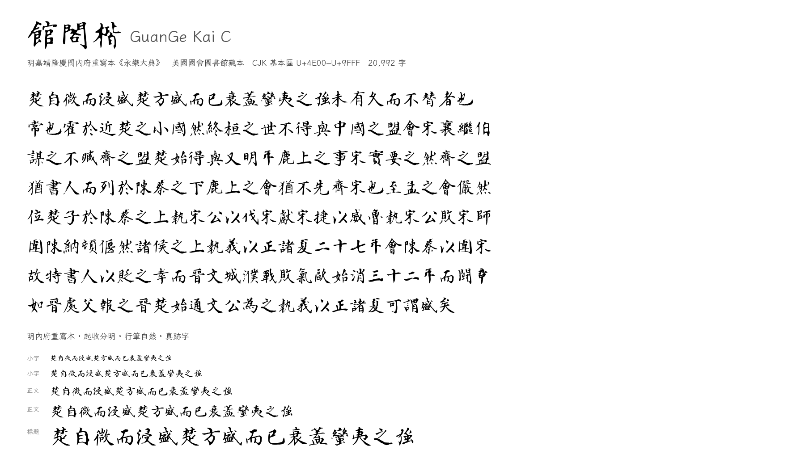
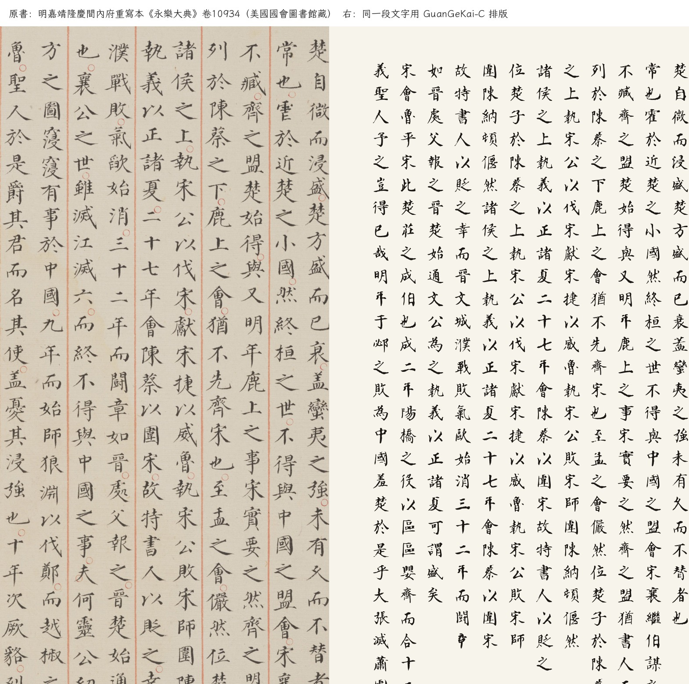

# 館閣楷 C　GuanGe Kai C

> 從明嘉靖隆慶間內府重寫本《永樂大典》（美國國會圖書館藏本）整理的一套館閣體開源字型，
> 覆蓋 CJK 基本區 U+4E00–U+9FFF 全部 20,992 字，SIL OFL 1.1 授權。
>
> **這是第三套（C 線）。** 第一套（A 線，家族名 `GuanGe Kai`）來自明代精寫本《四書白文》，
> 第二套（B 線，家族名 `GuanGe Kai B`）來自明抄本《史記》。三套字形來源不同，
> 可以同機安裝、分別選用。

<p align="center">
  
</p>

---

## 1. 這是什麼

**版本**：本包為 **GuanGe Kai C v1.2.0**，與 A 線 **GuanGe Kai v1.7.0**、
B 線 **GuanGe Kai B v1.2.2** 同步發布（同一專案、三個字形來源）。

**v1.2.0 變更**：v3c 全量重切（兩列墨跡中縫 + 每行白廊校驗、`merged/tiny/full`）；
真跡 **5,299**；從 v1.1.0 的 ep30 在 v3c pairs 上以 lr 1e-4 微調至 **ep34**；
頁留出 **0.451 / 6.63 / 14.1%**，按字留出 300 字 **0.584 / 5.38 / 1.3%**，均優於 v1.1.0；
ribbon 回退 7.9%→**6.0%**。

- `GuanGeKai-C-Regular.ttf`：完整字集 **20,992 字**（CJK 基本區 100%）
  ＝ 真跡 **5,299** 字 + GAN 生成 **14,758** 字（其中 935 字因守衛不通過或結構守衛，
  改用「帶狀掃掠」描繪）
- `GuanGeKai-C-Real.ttf`：只有 **5,299** 個真跡字，全部逐字從掃描本切出、向量化

真跡字的字形**直接來自寫本**：切字、去噪、potrace 向量化，再歸一到統一字身框。
生成字由 GAN（zi2zi U-Net + 5 層 PatchGAN + hinge + 數據增強）以霞鶩文楷為骨架、
以《永樂大典》筆形為風格生成。逐字來源見 `provenance.json`（`real` / `gan` / `ribbon_fb`）。

| 項 | 值 |
|---|---|
| 家族名 | `GuanGe Kai C` |
| PostScript 名 | `GuanGeKaiC-Regular`、`GuanGeKaiC-Real` |
| UPM | 1000（ASC 880 / DESC −120，字面框 0–880） |
| 格式 | TrueType（TTF/glyf），無 hinting |
| 授權 | [SIL Open Font License 1.1](OFL.txt) |

## 1.5 眼見為實：原書與字型對照

左邊是《永樂大典》卷 10934（楚字）原頁，右邊是同一段文字用本字型的真跡字豎排：

<p align="center">
  
</p>

## 2. 與 A、B 的分工

| | A 線 `GuanGe Kai` | B 線 `GuanGe Kai B` | **C 線 `GuanGe Kai C`** |
|---|---|---|---|
| 字形來源 | 明代精寫本《四書白文》（舊傳姜立綱，存疑） | 明抄本《史記》（舊傳姜立綱） | **明內府重寫本《永樂大典》** |
| 性質 | 名家精寫本 | 舊抄本 | **嘉靖內府錄副本（多人分抄）** |
| 掃描原生解析度 | 300 dpi | 150 dpi | **300 dpi** |
| 真跡字數 | 1,675（8.0%） | 4,078（19.4%） | **5,299（25.24%）** |
| 參考文本 | 有（四書白文） | 有（史記全文） | **無（類書，無錄文可對）** |

三套字的筆性不同：名家精寫本有運筆的方折與牽絲，舊抄本有墨筆的起收，內府錄副本出於多人分抄、
同一字常有幾種寫法。**不要混用**，
排版時整段選用同一套。若系統裡同時安裝，字型選單會顯示為三個家族。

## 3. 數據來源

- **原書**：明嘉靖隆慶間內府重寫本《永樂大典》，存 41 卷冊（卷 6831–19792），
  美國國會圖書館藏（41 個 LOC item：`2018421651`–`2018421670`、`2018433742`–`2018433762`）。
- **數字化**：美國國會圖書館；PDF 由書格（shuge.org）整理發布（PDF 元數據 `subject`）。
- **原書為公有領域**；掃描件是公版二維作品的**忠實再現**，本項目不主張任何權利，
  也不對掃描影像主張權利。詳細論證見 [`docs/DATA-C.md`](docs/DATA-C.md) §3。
- **沒有對照文本**：識典古籍等公開錄文最多到卷 7,602，本批 41 冊只有卷 6831–6832
  落在其覆蓋內且未確認有錄文。因此本線的標籤**不靠對齊**，靠雙引擎一致（見 §4）。

## 4. 字形處理鏈

```
PDF（41 冊 3,538 頁，全部 300 dpi）
  → 紅欄分欄 + 逐頁糾偏（朱絲欄是唯一的可靠直線）
  → 切字：OCR 行框定行（大字行≈整欄、小字行≈半欄），逐行 DP 切格
     1,214,431 格（雙行小注與大字字頭都不再按固定字距切）
  → 標籤：兩個獨立見證
       見證 A：PP-OCRv6（彩色頁）
       見證 B：PP-OCRv5（去紅 + 對比拉伸 + 1.3×）
     行級對齊後逐字比較：一致率 **93.0%**（雙見證格之間；含單見證為 90.3%），一致才給標籤；衝突置空
     篆/隸/草頁（222 頁，含「篆」或「隸+書」）整頁排除
  → 選優：每字穩健 medoid；全樣本都壞的字直接丟棄
  → 真跡：去噪 → potrace 向量化 → 字身框歸一 → 墨量標定（5,299 字）
  → 生成：GAN（30 輪，5 層 PatchGAN + hinge + 數據增強；ep20–30 已進平台）補齊缺字
  → 合字、質檢、打包
```

**乾淨集按頁留出**：隨機抽 6% 的頁（207 頁）完全不參與選優與訓練，
指標只在這批頁的多見證字上算。沒有參照文本時，「只出現一次的字」是全庫最不可信的
一批標籤，不能拿它當測試集。

## 5. 已知限制

1. **標籤沒有逐字人工校對。** 標籤來自 PP-OCRv6 與 PP-OCRv5 的一致結果；
   兩者不一致的格（約 9%）全部丟棄。少數形近字（曰/日、己/已）兩引擎同錯時無法發現。
   這是本線與 A/B 最大的差別，也是使用時最需要知道的一點。
2. **生成字不是真跡。** 15,693 個生成字由模型產生（其中 935 個，即 6.0%，
   因守衛不通過而走帶狀掃掠回退）。需要嚴格字形時請用 `GuanGeKai-C-Real.ttf`。
   合成字與真跡的字重比為 **0.948**（48px）；真跡墨量/文楷 **0.705**（B 線 0.730），已與 B 同級。
3. **寫本用字只覆蓋 5,299 字（25.24%）。** 剩餘 15,693 字是合成的。
4. **篆、隸、草書不收。** 依使用者要求只做楷體；帶篆/隸的「六書」頁整頁排除。
5. **沒有 hinting。** 小字號依賴系統自動微調。
6. **異體與簡化碼位**：寫本用字傳統，但 OCR 偶爾給出簡化碼位（如 `飞`、`书`）；
   這類碼位上的字形仍是傳統寫法，屬本字型的風格選擇。反之，`爲/為`、`閒/間`
   這類異體以寫本實際寫的字為準，不強行改成通行字。
7. 極少數頁面（地圖、襯頁、封面、以及無紅欄的殘頁）不參與真跡字表。

## 6. 授權與命名

- 字型本體：**SIL Open Font License 1.1**（見 `OFL.txt`）。可自由使用、修改、再分發，
  衍生字型須沿用 OFL 且**不得使用保留字型名**（霞鶩／霞鶩／落霞孤鶩／LXGW）。
- 原始碼：MIT（見 `LICENSE`）。
- 生成字由**霞鶩文楷**（OFL 1.1，含 Reserved Font Name）派生，故本字型必須 OFL，
  且家族名已避開其保留名稱：`GuanGe Kai C`。
- 本字型**不含**任何專有字型的資料；未混入與 OFL 不相容的授權資料。
- OCR 使用 RapidOCR（Apache-2.0）與 PP-OCRv6 / PP-OCRv5 模型（Apache-2.0）。

## 7. 致謝

- 藏本與數字化：**美國國會圖書館（Library of Congress）**
- 整理發布：**書格 shuge.org**
- 骨架與風格先驗：[霞鶩文楷 LXGW WenKai](https://github.com/lxgw/LxgwWenKai)（OFL 1.1）
- OCR：[RapidOCR](https://github.com/RapidAI/RapidOCR)（Apache-2.0）／PaddleOCR 模型

## 8. 建置（開發者）

```bash
python3 scripts/91_render_c.py --workers 6
python3 scripts/91b_recensus_c.py --workers 6
python3 scripts/92_ocr_c.py --workers 6
python3 scripts/93_segment_c.py --workers 6
python3 scripts/94_label_c.py
python3 scripts/74_make_holdout_c.py --frac 0.06
python3 scripts/05_select.py --work work-c --workers 6 --min-samples 2 \
        --holdout-pages work-c/holdout_pages.json --prefer-clean bad
python3 scripts/06_norm.py --work work-c --pitch-floor 180
python3 scripts/76_build_real_c.py --close 3 --hole-repair
python3 scripts/08_make_pairs.py --work work-c --out work-c/pairs/pairs.npz
python3 scripts/73_fit_width_c.py
python3 scripts/75_build_clean_c.py
python3 scripts/21_train_gan.py --data work-c/pairs/pairs.npz --out work-c/ckpt/c.pt \
        --ckpt-dir work-c/ckpt --sample work-c/preview/gan_sample.png \
        --patchgan --hinge --aug --epochs 30 --batch 16 --lr 2e-4
python3 scripts/82_eval_c.py --gan work-c/ckpt/c_ep030.pt --n 250 --sweep
python3 scripts/77_generate_c.py --method gan --workers 6 --res 512 --simplify 2.0 \
        --ckpt work-c/ckpt/c_ep030.pt --threshold 0.30 --close 1 --blend 0.8 --struct-guard \
        --out work-c/generated_gan.jsonl
mv work-c/generated_gan.jsonl work-c/generated.jsonl
python3 scripts/78_fill_fallback_c.py --work work-c
python3 scripts/79_build_full_c.py
python3 scripts/80_qa_c.py
python3 scripts/84_accept_c.py
python3 scripts/81_package_c.py
python3 scripts/83_verify_ab_c.py
```

全流程與實驗記錄見 [`docs/PLAN-C.md`](docs/PLAN-C.md)、
[`docs/EXPERIMENTS-C.md`](docs/EXPERIMENTS-C.md)、[`docs/DATA-C.md`](docs/DATA-C.md)。
