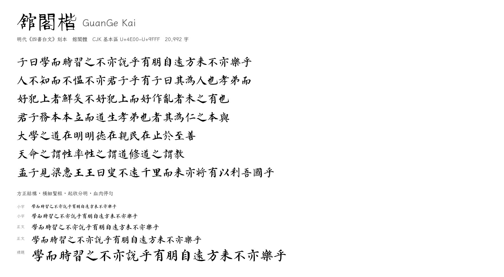
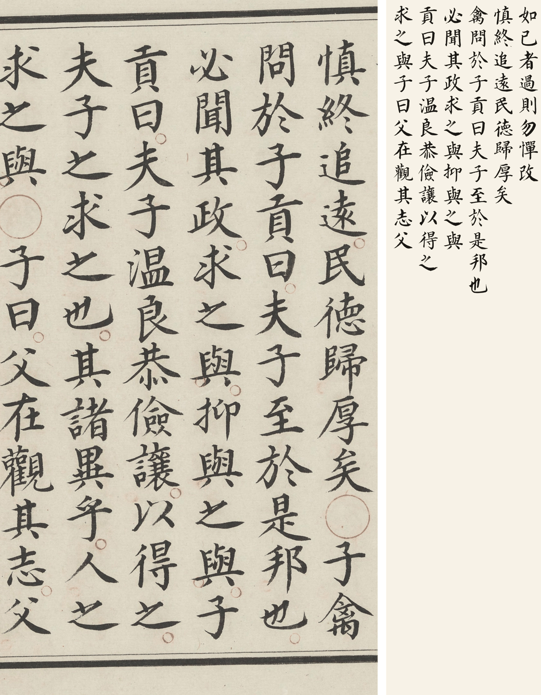

# 館閣楷 GuanGe Kai

> 三套以明代寫本為字形來源的**館閣體**開源字體：
> `GuanGe Kai`（四書白文）、`GuanGe Kai B`（史記）、`GuanGe Kai C`（永樂大典）。
> Three open-source *guan-ge-ti* (館閣體, Ming court regular script) typefaces, each built from a different Ming manuscript.

<p align="center">
  
</p>

> **狀態：A v1.7.2 / B v1.2.4 / C v1.2.0（2026-10-30）** —— 本專案含三套字體：
> 四書本（本頁，`GuanGe Kai`）、史記本（`GuanGe Kai B`，見 `README-B.md`）、
> 永樂大典本（`GuanGe Kai C`，見 `README-C.md`）。三套均為 20,992 字全覆蓋。
> 本頁以下內容只講 A 線；B、C 的指標與限制見各自的 README。
> 合成字的筆畫骨架取自霞鶩文楷，結構與其一致（拓撲相同率 97%），但**沒有真正的墨筆筆鋒**；
> 與寫本真跡的拓撲一致率約 47%，這部分差異繼承自基線字體。品質定位與已知限制見
> [docs/PROJECT_STATE.md](docs/PROJECT_STATE.md)，所有實驗與指標見
> [docs/EXPERIMENTS.md](docs/EXPERIMENTS.md)，資料與許可見 [docs/DATA.md](docs/DATA.md)。

## 三套字體

本專案同時維護三套獨立的館閣體，**各自訓練、各自評估、互不混用字形**：

| | A · 四書白文 | B · 史記 | C · 永樂大典 |
|---|---|---|---|
| 書體來源 | 名家精寫本（舊傳姜立綱，存疑） | 明抄本（舊傳姜立綱） | 嘉靖內府錄副本（**多人分抄**） |
| 家族名 | `GuanGe Kai` | `GuanGe Kai B` | `GuanGe Kai C` |
| 版本 | **v1.7.2** | **v1.2.4** | **v1.2.0** |
| 真跡 | 1,675 字 | 4,073 字 | **5,299 字**（基本區 25.2%） |
| 帶狀回退 | 4.1% | 3.5% | 6.0% |
| 覆蓋 | 20,992 / 20,992 | 20,992 / 20,992 | 20,992 / 20,992 |
| 字集 | CJK 基本區 20,992 + **標點/數字/空格 42** | 同左 | 同左 |
| 檔案 | `GuanGeKai-*.ttf` | `GuanGeKai-B-*.ttf` | `GuanGeKai-C-*.ttf` |
| 詳細 | 本頁 | [README-B.md](README-B.md) | [README-C.md](README-C.md) |

三套可同時安裝，用家族名區分。**字集只含 CJK 基本區與中文標點、數字、空格；
拉丁字母（A–Z）不在字庫內，由排版軟體的系統字體回退顯示。**各自的發布說明：
[A v1.7.2](docs/RELEASE-v1.7.2.md) · [B v1.2.4](README-B.md) · [C v1.2.0](docs/RELEASE-v1.2.0-C.md)。
舊版本的發布說明見 [docs/releases/](docs/releases/README.md)。

## 這是什麼


《四書白文》（十八卷，舊傳明·姜立綱書，原藏日本宮內廳書陵部（圖書寮數位檔案 shoryobu.kunaicho.go.jp，檔號 1000066720000））是一部典型的
**館閣體**寫本：結體方正、筆畫豐腴、橫細豎粗、起收分明。本項目把它變成一套可安裝、可再分發的
CJK 字體：

| 項目 | 內容 |
| --- | --- |
| 家族名 | GuanGe Kai（館閣楷） |
| 覆蓋 | CJK 基本區 U+4E00–U+9FFF，共 **20,992** 字 |
| 格式 | TTF（glyf，UPM 1000） |
| 授權 | SIL Open Font License 1.1 |
| 真實字形 | **1,675** 字直接取自掃描本（向量化；僅保留書中出現 ≥2 次、可做同字聚類校驗的字） |
| 生成字形 | **19,317** 字由程序化筆墨合成補齊（缺失字） |

字體分兩級發布：

* **GuanGeKai-Real** —— 只含掃描本真實字形（1,675 字），可視為「原字集」。
* **GuanGeKai** —— 完整 20,992 字，其餘由 19,317 個生成字形補齊。

原書（左）與本字體排印相同文字（右）：

<p align="center">
  
</p>

## 字形來源與方法

```
PDF 掃描 (410 頁)
   ↓  去紅圈點 / 去框線 / 糾偏 / 網格與連通域分割
54,000+ 個單字切片
   ↓  PP-OCR 逐欄轉錄 + 《四書》標準文本對齊 + 同字聚類投票
2,300 個字的標註（保留 1,675 個可交叉校驗的字）
   ↓  potrace 向量化 / 基線與字身框歸一化
GuanGeKai-Real
   ↓  缺失字（三層結構，見下）
19,317 個合成字形 → 向量化
   ↓  合併、構建 OpenType
GuanGeKai (20,992 字)
```

### 字庫構成（v1.5.1）

```
20,992 字
├─ 1,675  真跡   直接取自寫本，不經過任何模型
└─ 19,317 合成
   ├─ 17,790  GAN（m2wt-ep90）      92.1%  ← 主模型（複雜度加權）
   ├─    728  GAN（m2-ep80 補位）    3.8%  ← 主模型過不了守衛時
   └─    799  帶狀掃掠回退            4.1%  ← 兩個模型都過不了守衛時
```

守衛三條（任一不滿足即換模型再試，都失敗才整字回退帶狀掃掠）：**空輸出 / 墨量比不在 [0.6, 1.5] / 連通域數與基線字體相差 >3**。
回退偏向筆畫多的字（回退字平均墨量 13,695，GAN 字 12,479）。

> 有真跡的字**一定**用真跡；GAN 只負責書中沒有的字，且出問題時退回帶狀掃掠。

細節見 [docs/method.md](docs/method.md)。

## 文檔索引

| 文檔 | 給誰看 | 內容 |
|---|---|---|
| [docs/method.md](docs/method.md) | 想懂技術路線的人 | 從掃描到字體的完整流程與參數 |
| [docs/PROJECT_STATE.md](docs/PROJECT_STATE.md) | **接手的 agent / 審計者** | 現狀、決策、已知缺陷、未決問題、審計方法 |
| [docs/EXPERIMENTS.md](docs/EXPERIMENTS.md) | 想复現或質疑結論的人 | 40 組實驗（E1–E40）的配置、指標、判定、复現命令 |
| [docs/DATA.md](docs/DATA.md) | 關心許可與來源的人 | 輸入/輸出清單、逐項許可、校驗和、重建步驟 |
| [docs/RELEASE-v1.7.2.md](docs/RELEASE-v1.7.2.md) | 想了解本版改了什麼的人 | **A v1.7.2**：字集口徑定稿（20,992 + 42 = 21,034）、工作點固化 |
| [docs/releases/RELEASE-v1.7.0.md](docs/releases/RELEASE-v1.7.0.md) | 考古的人 | v1.7.0：字體元數據與術語更正 |
| [README-B.md](README-B.md) | B 線本版說明 | **B v1.2.4**：字集口徑 20,992 + 42 = 21,034（v1.2.4 由 B 線重出） |
| [docs/RELEASE-v1.2.0-C.md](docs/RELEASE-v1.2.0-C.md) | C 線本版說明 | **C v1.2.0**：v3c 全量重切、守衛回退尺寸修復 |
| [docs/releases/](docs/releases/README.md) | 考古的人 | 已被取代的 17 份發布說明（按線與版本索引） |
| [README-B.md](README-B.md) | 想用史記本的人 | GuanGe Kai B v1.2.4 |
| [README-C.md](README-C.md) | 想用永樂大典本的人 | GuanGe Kai C v1.2.0 |
| [docs/PLAN-v1.5.md](docs/PLAN-v1.5.md) | 想知道下一步的人 | 把 GAN 推到可驗收的四個里程碑（M0–M4）與決策點 |
| [docs/PLAN-v1.4.md](docs/PLAN-v1.4.md) | 考古的人 | **已作廢**：v1.4.0 起三線並行的原始設想 |
| [docs/REPORTS/](docs/REPORTS/) | 想看實測數據的人 | 每次橫向評測的完整報告（指標表 + 兩個面板） |

## 安裝

```bash
# macOS
cp build/GuanGeKai-Regular.ttf ~/Library/Fonts/
# Linux
cp build/GuanGeKai-Regular.ttf ~/.local/share/fonts/ && fc-cache -f
```

## 從源碼重建

```bash
python3 -m venv .venv && source .venv/bin/activate
pip install -r requirements.txt

python3 scripts/01_segment.py          # PDF -> 單字切片 (約 4 分鐘, 12 進程)
python3 scripts/02_ocr.py              # 逐頁 PP-OCR
python3 scripts/03_build_reference.py  # 生成《四書》標準文本
python3 scripts/04_label.py            # 切片 -> 字
python3 scripts/05_select.py           # 每字挑最優樣本（默認剔除僅出現 1 次的字）
python3 scripts/06_norm.py             # 字身框歸一化參數
python3 scripts/07_build_real.py       # 真實字形子集字體
python3 scripts/10_generate.py --method gan    # 生成缺失字（發布版：GAN + 守衛）
python3 scripts/36_fill_fallback.py            # 補齊守衛回退的字（帶狀掃掠）
python3 scripts/11_build_full.py       # 合成完整字體
python3 scripts/12_specimen.py         # 樣張
python3 scripts/13_qa.py               # 覆蓋率質檢
python3 scripts/14_package.py          # 發布包
```

> **v1.5.0 起發布版依賴訓練**：合成字由 GAN 生成（`--method gan`），
> 需要檢查點 `work/ckpt/m2_ep080.pt`（380 MB，不入庫；重訓見 `docs/PLAN-v1.5.md`）。
> 沒有檢查點時可退回 `--method ribbon`——畫質較弱（Dice 0.414 vs 0.549），但不需要模型。
> 複現實驗見 [docs/EXPERIMENTS.md](docs/EXPERIMENTS.md)。

原始 PDF 需放在倉庫根目錄，檔名為 `四书白文.18卷.旧传明.姜立纲.pdf`（版權原因**不入庫**）。
基線字體 `data/base/LXGWWenKai-Regular.ttf` 需自行從
[LXGW WenKai releases](https://github.com/lxgw/LxgwWenKai/releases) 下載（同樣不入庫）。

## 已知限制

* 生成字形（19,317 字）的骨架來自基線字體，筆形由 **GAN** 生成（v1.5.0 起；9.5% 觸發守衛時
  回退為帶狀掃掠）。在 617 個從未參與訓練的字上：Dice 0.549、骨架 chamfer 5.92px
  （真跡互比地板 5.16px，仍差 15%）。
* **合成字比真跡重約 17%**（E34）：全字號恆定。拆開是 **5–7% 字集構成**（生僻字本身墨多）
  + **約 5% 來自模型輸出的字面偏小**（包圍盒是真跡的 0.949，歸一化放大後墨量跟著漲，E37）。
  模型逐字輸出本身是準的（0.995）。**不是一個能乘上去的常數**，也沒有輪廓膨脹可補
  （E37 實測輪廓/掩膜 = 0.9997）；要修只能改模型或歸一化策略。
* 掃描本只覆蓋《四書》用字（1,675 個校驗後字形），因此大部分現代常用字屬於生成字形。
* 尚未做 hinting；大字号、印刷級輸出請自行 outline。

## 授權

* 字體：SIL Open Font License 1.1，見 [OFL.txt](OFL.txt)。
  生成字形衍生自 [LXGW WenKai](https://github.com/lxgw/LxgwWenKai)（OFL 1.1，保留字體名
  「霞鹜/霞鶩/落霞孤鹜/落霞孤鶩/LXGW」），本項目已按 OFL 要求更名為 GuanGe Kai。
* 代碼（`scripts/`）：MIT（見 `LICENSE`）。
* 掃描圖像：原書藏於日本宮內廳書陵部，數位化由其圖書寮數位檔案完成
  （檔號 1000066720000）；本項目使用的 PDF 為書格（shuge.org）整理發布的版本。
  字形是對公有領域 2D 作品的忠實再現，本項目不對掃描圖像本身主張權利。

## 致謝

本項目的字形品質來自「別人的字」遠多於我們的代碼。以下按用途分類，
**每一項都說明我們用了它的什麼或受了它什麼啟發**。

### 緣起：最早的三個參考

本項目最早的技術路線，是照著這三個項目定下來的（都只看流程，沒有複製代碼/數據）：

* **[qiji-font 齊伋體](https://github.com/LingDong-/qiji-font)** —— 「寫本掃描 → 切字 → OCR → 字體」的完整流程樣板，
  我們的分頁、切格、OCR 校驗、字形歸一化都受它啟發
* **[Image-to-font-extractor](https://github.com/wyattmattoe/Image-to-font-extractor)**（MIT）——
  「字形圖 → SVG → 可安裝 TTF」的最小可行路徑，確立了我們「先出字體、再談風格」的順序
* **[FontForge](https://github.com/fontforge/fontforge) / [fontTools](https://github.com/fonttools/fonttools)** ——
  字體組裝工具；最終實現全部走 fontTools（FontForge 僅作流程參考）

### 數據與掃描

* **日本宮內廳書陵部（圖書寮數位檔案）** —— 原書藏本與**數位化掃描**（檔號 1000066720000）
* **書格 shuge.org** —— 將該掃描整理成可下載的 PDF（**掃描並非書格製作**）
* 說明：本 PDF 已被去色（實測 `r−g` 最大僅 11–14，無紅色像素），原書的**紅色圈點**在我們這份檔案裡
  已變成深灰，故顏色分離無效，實際用「厚度 + 連通域」判據剔除（`scripts/pageproc.py`）。
  若使用未去色的掃描，`red_mask()` 仍可直接生效。

### 字體（OFL）

* **[LXGW WenKai 霞鶩文楷](https://github.com/lxgw/LxgwWenKai)** —— 19,317 個缺失字的**結構骨架**；
  本字體是它的衍生作品，已按 OFL 要求避開保留字體名
* **Noto Serif SC / 思源宋體** —— 作為「內容字形」輸入（zi2zi 系列實驗）與對照基準

### 工具

* [FontTools](https://github.com/fonttools/fonttools) —— 字體組裝（UPM、name 表、cmap、輪廓寫入）
* [potrace](http://potrace.sourceforge.net/) / [potracer](https://pypi.org/project/potracer/) —— 點陣轉向量
* [OpenCV](https://opencv.org/)、[NumPy](https://numpy.org/)、[SciPy](https://scipy.org/)、
  [scikit-image](https://scikit-image.org/)、[Pillow](https://python-pillow.org/) —— 影像處理
* [RapidOCR / PP-OCR](https://github.com/RapidAI/RapidOCR) —— 逐頁轉錄（OCR）
* [PyMuPDF](https://pymupdf.readthedocs.io/) —— PDF 渲染與頁面處理

### 參考項目與思想

* **[kaonashi-tyc/zi2zi](https://github.com/kaonashi-tyc/zi2zi)**（Apache-2.0）——
  `zi2zi-GAN` 的配方來源：U-Net + 全局判別器 + `L1×100 + 對抗 + 常量損失`，由我們獨立重寫為
  `scripts/21_train_gan.py`，未使用其任何權重
* **[kaonashi-tyc/zi2zi-JiT](https://github.com/kaonashi-tyc/zi2zi-JiT)**（代碼 MIT）——
  `zi2zi-JiT` 的架構；**其預訓練權重沒有許可聲明**（LICENSE 僅寫 "MIT License (Software)"），
  故本項目只將其輸出作為**評價參考**，從未進入發布字體
* **[computer-grass](https://github.com/LingDong-/computer-grass)** —— 逐筆墨量擾動 `dip`
  與「針狀收筆」的思路；其字形數據的授權與 OFL 不兼容，**未使用**
