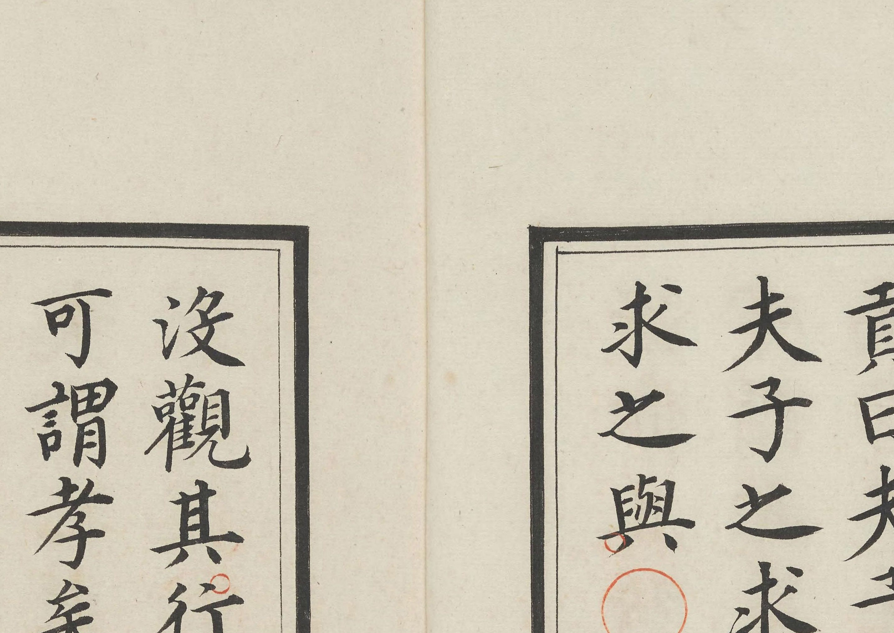

# 术语与命名：迁移方案（2026-10-28）

> **本文是迁移计划，不是规范。** 规范落定后以 `docs/GLOSSARY.md` 为唯一来源；
> 本文在 `scripts/97_check_terms.py` 全绿后降级为历史记录。
>
> 三线分工：A 线会话负责共享文档与代码注释；B、C 线各自负责 `README-B/C.md` 与 `docs/*-B/C.md`。
> 本文所有数字均已在本仓库复核（2026-10-28）；与上一版方案的差异见 §9。

## 1. 为什么要改

1. **事实错误**：《四书白文》被写成「刻本」，实为**明代精写本**（手书）。影响 72 处文档、
   1 处字体元数据、5 处脚本注释、1 个样张生成器。
2. **命名冲突**：技术路线与字形线都叫 A/B/C；技术路线若再改用 R+数字，会撞上闸门判据编号 R0–R7。

## 2. 事实更正：写本，不是刻本

### 2.1 一手证据（本项目手上的 PDF，优先于任何网站著录）

取 `四书白文.18卷.旧传明.姜立纲.pdf` 第 11 页 600 dpi 局部 → `docs/images/manuscript-evidence.jpg`。



按判别力分三级（**不要混着说「足以单独成立」**）：

| 级别 | 观察 | 说明 |
|---|---|---|
| **决定性** | **版心空白**：中缝无书名、卷次、叶码、刻工、牌记 | 刻本正常会在版心刻这些；此书没有（第 11 页书口为空白折缝） |
| **强旁证** | 笔画有墨色浓淡、末端锋芒、牵丝飞白；同一页字径不匀、基线起伏 | 精刻本能摹刻笔意，故列为强旁证而非铁证 |
| 旁证 | 书格归入「稿钞本」、著录「明代精写本」 | 二手，仅作参考 |

**不列入证据的两条**（曾经写进上一版，已删）：

- 「边框是墨线双框」——墨线双框恰恰是**刻本的常态**，写本反而多用朱丝栏，此条不支撑结论；
- 「朱圈与墨字颜色分层」——刻本的读者同样会手加圈点，两者都有，无判别力。

### 2.2 旁证（书格页面著录）

| 项 | 内容 |
|---|---|
| 站点类目 | 归入「**稿钞本**」 |
| 正文 | 「旧传为明代书家姜立纲**手书**……此为**明代精写本**」 |
| 站方原站文件名 | `四书白文.十八卷.旧传明.姜立纲.书.**明钞本**.王世贞.赵用贤跋` |
| 书写信息栏 | 「明代初期**钞本**？」 |

**两处易混**：

- 本地文件名是 `四书白文.18卷.旧传明.姜立纲.pdf`，**没有「明钞本」三字**；
  引用时不要把原站文件名当成本地文件的名字。
- 王世贞、赵用贤跋是书格对该藏本的著录，**不要写成「本件卷末有跋」**，须注明「据书格著录」。

### 2.3 顺带更正一个数字

旧文档写「A 线红像素 0.08–0.16%」（`AGENTS.md` 常见坑一节）。**不要再用窄区间替换窄区间。**
全库 410 页实测（100 dpi，`pageproc.red_mask`）：

```
p5 0.086% | 中位 0.265% | p95 19.97% | 最大 97.99%
<0.18% 的页 123 张；>0.27% 的页 201 张；>5% 的页 22 张（红封面 / 红印 / 暖色纸）
正文页抽样 8 页：0.098–0.271%
```

写法改为：**「正文页约 0.1–0.4%，中位 0.27%；全书跨度大（有整页发红的例外），不要当常数用」**。
结论不变——`red_mask()` 一直在跑，四书这份红色标记少、收益接近 0。

### 2.4 术语替换表

| 旧 | 新 | 备注 |
|---|---|---|
| 刻本 / 明刻本 / 馆阁体刻本 | **写本 / 明写本 / 馆阁体写本** | 首次出现可写「明代精写本」 |
| 刻本真迹 | **写本真迹**（或「真迹」） | |
| 刻刀笔锋 | **墨笔笔锋** | |
| 原书印刷断笔 | **书写连笔 / 磨损** | |
| 刀刻刻本（B/C 对 A 的描述） | **墨笔写本** | |
| 三条线：刻本 / 抄本 / 类书 | **名家写本 / 旧抄本 / 内府录副本** | |

### 2.5 **不用**改的（避免误工）

- **所有指标不重算**：Dice、墨量、chamfer、孔洞、端帽都是对图像测的，与刻/写无关。
- **已发布制品不动**：`release*/`、zip、校验和。详见 §4。
- **历史发布说明保留原文**：只改「结论句里承重的表述」，其余靠 `docs/ERRATA.md` 统一勘误。

### 2.6 有一批**理由**要跟着复核（改词不改理由会留下逻辑悬空）

| 位置 | 现有理由建立在 | 改成 |
|---|---|---|
| A 线待办「转折（横折方角，建议 miter join）」 | 刻刀的角状收笔 | 写本折笔的顿挫（`brush_lib` 的 `end_skew`/`taper` 本就按毛笔拟合） |
| E37「无法复刻刻刀的角状收笔」 | 同上 | 「无法复刻写本折笔的方角」 |
| E37「4 个角状收笔（类似刻本顿笔）」 | 同上 | 「类似写本顿笔」 |
| README「橫細豎粗」的成因 | 刻工刀法 | 运笔提按 |
| 端帽指标（cap_mid / capKS）的解释 | 刻刀起收 | 毛笔起收（数值不变） |
| 「与刻本真迹拓扑一致率 47%」 | 参照物名字 | 「与写本真迹……」，数值不变 |

## 3. 命名规范

### 3.1 字形线（不变）

| 线 | 家族名 | 语料 | 定位（**按书写者与场合区分**，不按载体） |
|---|---|---|---|
| **A 线** | `GuanGe Kai` | 《四书白文》十八卷 | **名家精写本**（旧传姜立纲）：个人风格最纯，最接近台阁体的「标准手」 |
| **B 线** | `GuanGe Kai B` | 《史记》二十四册 | **旧抄本**（旧传姜立纲）：抄手水平参差，笔画更率 |
| **C 线** | `GuanGe Kai C` | 《永乐大典》美国藏本 41 册 | **嘉靖内府录副本**：多人分抄，同字多形，最「官」也最杂 |

三条线**都是写本**，差异在书写者与场合，不在刻还是写。

> 术语附注（进 GLOSSARY）：明代文献多称「台阁体」，清代多称「馆阁体」；本项目以**馆阁体**作通称，
> 引用明代语境时保留「台阁体」。字体名不改。

### 3.2 技术路线（换编号）

**R0–R7 已被闸门判据占用**（`docs/EXPERIMENTS.md:798`、`scripts/30_gate_rules.py:66-73`），
不得再用 R + 数字。

| 规范写法 | 短码（仅表格内；首次出现写全） | 含义 | 当前状态 |
|---|---|---|---|
| `ribbon` | `RT1` | 带状扫掠 | **降级为回退兜底**（A 线 799 字 4.1%、B 线 591 字、C 线 1,228 字 7.8% 仍在用，不是「已退役」） |
| `zi2zi-GAN` | `RT2` | PatchGAN 生成 | 三线主线 |
| `zi2zi-JiT` | `RT3` | 自训练权重 | 未启动 |

代码里已在用 `--method gan` / `--method ribbon` / `patchgan`，**文档跟代码对齐，不需要额外图例**。

**禁止**：`路线 A`、`路线 B`、`路线 C`、`方案 A/B/C`（`docs/PLAN-v1.2.md` 与 `PLAN-v1.4.md` 都在用）。

### 3.3 版本号与文件名

旧规则「版本号永不带线字母」与既有发布物冲突（`GuanGeKai-B-v1.2.1.zip`、`docs/releases/RELEASE-v1.1.0-B.md`）。
收窄为：

> **版本号本身只写 `vX.Y.Z`**（如 `v1.2.1`），不把线字母写进版本号内部（禁止 `v1.2.1-B`）。
> **文件名允许带线名**：`GuanGeKai-B-v1.2.1.zip`、`RELEASE-v1.2.1-B.md` 合法，其中 `B` 是线名不是版本。

### 3.4 路径不对称（承认，不改）

`work/`、`release/`、`data/release-a.json` 对 A 线**无后缀**，B/C 有 `-b`/`-c`。历史原因，
改动成本过高，**保留现状**，在 GLOSSARY 写明「无后缀即 A 线」。

## 4. 打包决策：只改仓库，包内不动

改根 `README.md` 会连带 `release/README.md`（打包脚本复制）与 `release/SHA256SUMS`（含 README 一行），
进而改变 zip 哈希；而 `scripts/83_verify_ab_c.py:31` **硬编码**了 `GuanGeKai-v1.6.5.zip` 的哈希：

```python
ZIPS = {"GuanGeKai-v1.6.5.zip": "226ef25d43fde048e4b08f930672aa8ac3615c2f4fbe0680eb5520ac52380cf0", ...}
```

重打包 → 83 报错 → C 线发版闸门失败。

**决定（三线统一）**：

1. 只改**仓库内**文档，`release*/` 与三个 zip **不动**；
2. `docs/DATA.md` 与 `docs/DATA-B/C.md` 各加一行：「包内 README 停留在发布时的措辞（『刻本』），
   仓库文档已更正为『写本』，属已知 drift，不重新发版」；
3. `83_verify_ab_c.py` 的 `ZIPS` 加注释：zip 哈希是发布时的快照，不随文档变动；
   **`release*/specimen.png`（图上印着「明代《四書白文》刻本」）同属快照**，一并登记 drift；
4. 三个包的 README 与仓库 README 从此**不再要求逐字节一致**（`AGENTS.md` 踩坑第 1 条的例外）。

## 5. 迁移清单（按位置，不只是文档）

### 5.1 共享文档（A 线会话）

| 优先级 | 文件 | 处数 | 动作 |
|---|---|---|---|
| P0 | `docs/PROMPT-SHIJI.md` | 2 | **新会话入口，最优先** |
| P0 | `docs/PROMPT-YONGLE.md` | 2 | 同上 |
| P0 | `AGENTS.md` | 3 处「刻本」+ 90/94/128 行 | 术语 + 把方法叫「线」的三句改掉 + 加命名规范 |
| P0 | `README.md` | 7 | 术语 + **定位段重写**（见 §6） |
| P0 | `docs/DATA.md` | 1 | 来源性质 + drift 说明 |
| P0 | `docs/PROJECT_STATE.md` | 8 | 术语 + 三线定位 |
| P0 | `scripts/12_specimen.py:29` | 1 | 「刻本」→「寫本」，并重出 `docs/images/specimen.png` |
| P1 | `docs/PLAN-v1.4.md` | 8（路线 A/B/C）+ 1（刻本） | 顶部加作废声明：路线 A/B/C → ribbon / zi2zi-GAN / zi2zi-JiT；`GuanGeKai-A-ribbon.ttf` 等文件名提案作废 |
| P1 | `docs/PLAN-v1.2.md` | 4（方案 A/B/C） | 同上 |
| P1 | `docs/method.md` | 6 | 术语 |
| P2 | `docs/EXPERIMENTS.md` | 11 | 术语 + §2.6 的理由复核 |
| P2 | `docs/RELEASE-v1.2.x/v1.3.x/v1.5.0/v1.6.1` | 14 | **不改**，靠 `docs/ERRATA.md` |
| P2 | `docs/AUDIT-2026-10-27.md` | 2 | 历史审计，不改，ERRATA 覆盖 |

### 5.2 代码与字体元数据（A 线会话；上一版方案漏了这块）

| 文件 | 问题 | 动作 |
|---|---|---|
| `scripts/11_build_full.py:51` | name ID 0 写 `Ming woodblock print` | 改 `Ming manuscript`；**下次发版生效**，本版 `build/*.ttf` 元数据保留并在 RELEASE/ERRATA 注明 |
| `build/GuanGeKai-Regular.ttf` name ID 0 | 已带 `woodblock print` | 不重建不改，写入 ERRATA |
| `scripts/09_train_b.py:1`、`16_m0_discriminate.py:3`、`brush_lib.py:210`、`pageproc.py:3` | docstring 里 `woodblock` | 改注释 |

### 5.3 B 线（B 线会话）

`README-B.md` 5、`docs/DATA-B.md` 1、`docs/EXPERIMENTS-B.md` 2、`docs/PLAN-B.md` 1；
历史 `RELEASE-v1.1.0-B.md` 1 不改。

### 5.4 C 线（C 线会话）

`README-C.md` 4、`docs/RELEASE-v1.0.1-C.md` 1；`docs/DATA-C.md` 补一节「A 线语料性质更正」。

## 6. 三条线定位重写，不是替换词

原叙事用「三种载体」区分三线（刻本 / 抄本 / 类书）。更正后三者全是写本，那句话作废；
替换句若只写「写本也有运笔的方折与牵丝」，对 B、C 同样成立，读者看不出差别。

改为**书写者与场合**（§3.1 表）。这同时是 A 线的**定位升级**：

> 姜立纲是明代台阁体的代表人物。原来写「刻本」，读者会问「刻本凭什么叫馆阁体」；
> 改成「名家精写本」之后，A 线是三线里最正统的馆阁体样本，字体名叫「馆阁体」才立得住。

`README.md` 开头（第 3 行起）应重写这一段，而不是替换两个字。

## 7. 验收：脚本，不是 grep

`scripts/97_check_terms.py`（已建。A/共用部分已改完，当前 **剩 17 处，全部在 B/C 线文档**）：

- 扫 `*.md`、`docs/*.md`、`scripts/*.py`、三个 `release*/README.md`；
- 词表：`刻本`、`刻刀|刀刻|雕版|版刻|摹刻|翻刻`、`woodblock|block-print`、`路线 A/B/C`、`方案 A/B/C`；
- 扫字体 name 表（ID 0/1/4/5/10），按 `(nameID, text)` 去重；
- **R 编号**：文档与脚本里出现 `R0/R0b/R1–R7` 即报（gate 表格行 `| R1 …` 与 `30_gate_rules.py` 豁免）；
- **显式豁免**：合法用法在该行尾加 `<!-- term-ok -->`，不做关键词猜测
  （上一版用「含抄本即四书语境」的启发式，把 `DATA-B:99` 误判成硬错、把十几处真错误判成 soft 吞掉）；
- **已知遗留**分节输出、不影响退出码：`build/*.ttf` 的 name 表、`release*/README.md`
  （见 §4 与 `ERRATA.md` E2/E3/E4）；
- 白名单：`GLOSSARY`/`CONVENTIONS`/`ERRATA`/本脚本/`30_gate_rules.py`，以及 `docs/RELEASE-*`、`docs/AUDIT-*`（历史）。

「全绿」= 除白名单与已知遗留外无命中。挂进 `AGENTS.md` 发布流程（与 `83_verify_ab_c.py` 同位置）。

## 8. 单一规范源与档案

| 文件 | 角色 |
|---|---|
| `docs/GLOSSARY.md` | **唯一规范**：词表、编号、三线定位、版本/文件名规则、路径不对称 |
| `docs/CONVENTIONS.md`（本文） | 迁移计划；`97_check_terms.py` 全绿后加「已完成」横幅，降级为历史 |
| `docs/ERRATA.md` | 统一勘误：本文 §2 结论、历史文档不改的部分、字体元数据遗留 |

## 9. 与上一版方案的差异（自我更正）

| 项 | 上一版 | 本版 | 依据 |
|---|---|---|---|
| 技术路线编号 | R1/R2/R3 | `ribbon`/`zi2zi-GAN`/`zi2zi-JiT`（短码 RT1–RT3） | R0–R7 已被 `30_gate_rules.py` 占用 |
| 「路线 A/B/C」处数 | ~30，集中在 PLAN-v1.4/AGENTS/EXPERIMENTS | **14**：PLAN-v1.4 8、本文 6；AGENTS/EXPERIMENTS 为 **0**（它们用「A 带状扫掠」这种更隐蔽写法，另列 3 句） | 全量 grep |
| PROMPT 文件 | 未列 | **P0 最优先** | 新会话入口 |
| 打包 | 「release 一律不动」+ 改 README（自相矛盾） | 只改仓库，包内 drift 登记 | `83_verify_ab_c.py:31` 硬编码 zip 哈希 |
| 版本规则 | 「永不带线字母」 | 版本号不带、文件名可带 | `GuanGeKai-B-v1.2.1.zip` 等既有产物 |
| 证据 | 二手（站点类目、读者回复） | **一手（§2.1 图像）** + 旁证 | 本地 PDF 可判读 |
| 红像素 | 0.08–0.16% | **0.18–0.27%** | 4 页重测 |
| 范围 | 文档 | 文档 + 代码注释 + 字体元数据 + 样张生成器 | 代码里 `woodblock` 5 处、`刻本` 1 处 |
| 验收 | grep，且会命中自己 | 脚本 + 白名单 + 退出码 | 自测 |
| 定位叙事 | 只改措辞 | **按书写者与场合重写，A 线定位升级** | §6 |
| 退役条件 | 无 | 迁完即降级为历史 | §8 |
| 规范源 | 「GLOSSARY 待建」但已引用 | **GLOSSARY / ERRATA 已实际建立** | `ls docs/GLOSSARY.md docs/ERRATA.md` |
| 证据判别力 | 五行平铺，「足以单独成立」 | **三级：决定性（版心空白）/ 强旁证 / 旁证**，删掉无判别力的两条 | 第 11 页书口空白 |
| 红像素 | 4 页区间 0.18–0.27% | **全库 410 页分布**（p5 0.086 / 中位 0.265 / p95 19.97 / max 97.99） | 全量扫描 |
| 检查器上下文判定 | 行内关键词启发式（会吞真错误、误伤合法行） | **显式 `<!-- term-ok -->`** | 实测 91 处 vs 旧报告的 30 处 |
| 字体二进制 | 无条件扫，导致「全绿」不可达 | **列为已知遗留**，不参与退出码 | ERRATA E2 |
| 包内快照 | 只登记 README | README + **specimen.png** 一起登记 | release 的 SHA256SUMS 含二者 |

## 10. 执行顺序

```
0. docs/GLOSSARY.md、docs/ERRATA.md  ── 已建（2026-10-28），规范先于迁移
1. P0 共享文档 + PROMPT-*（新会话入口最先）
2. 代码注释与 name 表（11_build_full.py 下次发版生效）
3. PLAN-v1.4 / PLAN-v1.2 顶部作废声明
4. scripts/12_specimen.py 已改；仓库内 specimen.png 可重出（包内不动，见 §4）
5. 跑 scripts/97_check_terms.py：A/共用已清（91 → 17，余下全在 B/C 文档），等 B/C 清零后挂闸
6. B/C 线各自执行 §5.3 / §5.4
7. 全绿后本文加「已完成」横幅，降级为历史
```

**顺序反了会出现「文档说写本、字体元数据说 woodblock、检查脚本还绿着」的状态。**
