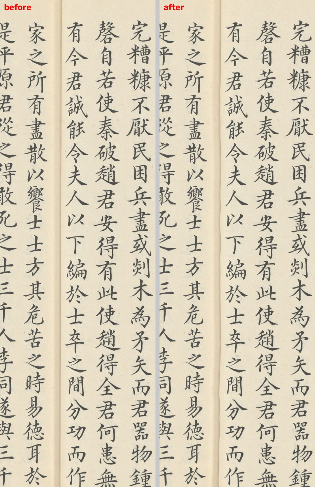
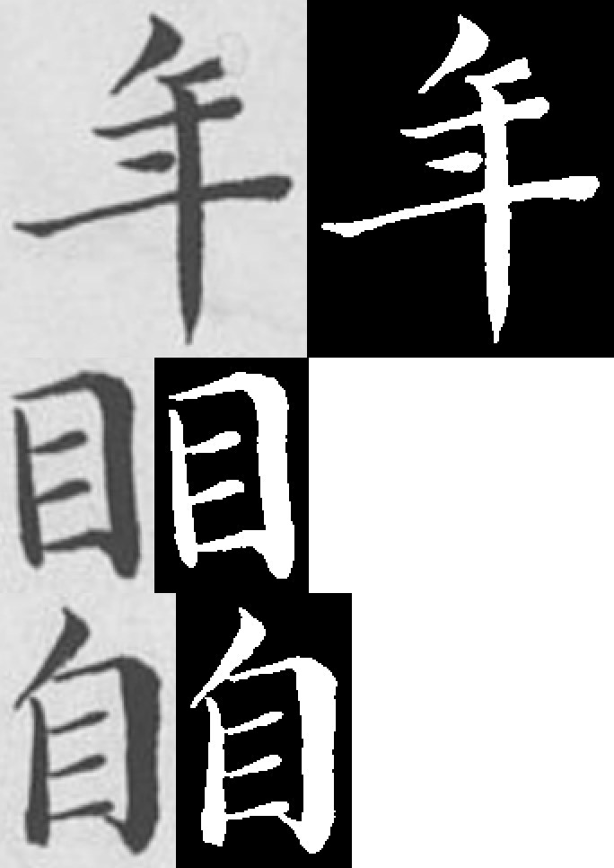
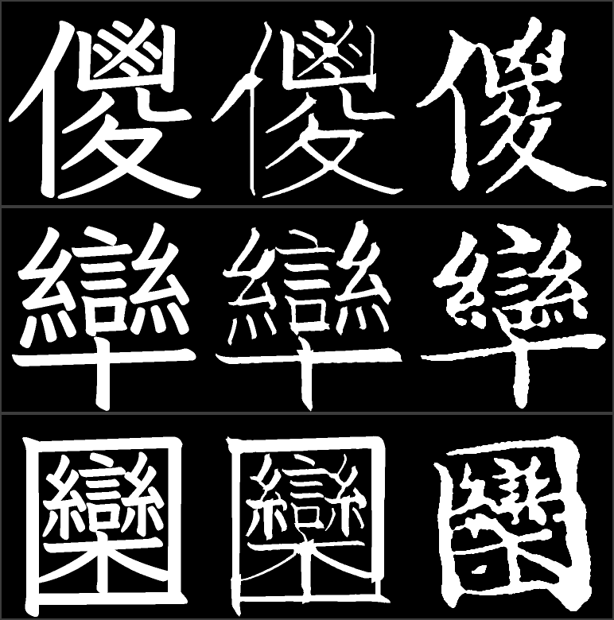

# B 线实验记录（史記 → GuanGeKai-B）

> 一条实验一节，格式：**配置 / 指标 / 判定 / 复现**。
> 本线所有指标一律以**史记自己的真迹**为参照；四书的数字只作并行对照，不参与判定。
> 最后更新 2026-10-25。

---

> 本文件只记录 **B 线（史记）** 的实验；A 线（四书）的 B/E1–E37 在 `docs/EXPERIMENTS.md`。
> 两边的编号独立，引用时请写明「A/E36」「B/E6」。

## E0 · 数据几何与切字审计

**目的**：在动手做字体之前，先把「这份扫描到底是什么」测清楚——分辨率、版式、字距、
页结构（对开/单叶/空白页）、水印。A 线的一切数据侧常数都建立在四书的几何上，
必须先知道 B 线的几何与它差多少。

**配置**

| 项 | 值 |
|---|---|
| 输入 | `史记.二十四册.传姜立纲抄本.新加坡国立大学藏.水印.pdf` |
| 内嵌影像 | 2250×2100 px，页面 1080×1008 pt → **原生 150 dpi** |
| 渲染 | 300 dpi（4500×4200），1 源像素 = 2 渲染像素 |
| 切字 | `51_segment_b.py --workers 8`（先纠偏，见 B/E1） |
| 硬件 | M3 Ultra 32 核；8 worker × 1 线程（遵守 ≤20 核预算） |

**指标**

| 项 | 结果 |
|---|---|
| 页数 | **1672** |
| 有字页 / 空页 | **1613 / 59**（空页集中在各册首尾：0,4,67,68,139,140,203,204,256–258,…） |
| 单叶页（另一半为空白） | **56** |
| 字格总数 | **473,847** |
| 每页字格 | 中位 **319**，p10 146，p90 320，最大 336 |
| 栏数 | 有字页中位 **16** |
| 字距 pitch（300 dpi） | 中位 **174.0**，p10 172.6，p90 175.7 |
| 字格宽/字距 | 中位 0.910（p5 0.655，p95 1.093） |
| 字格高/字距 | 中位 0.859（p5 0.595，p95 1.057） |
| 字格宽高比 | 中位 **1.061** |
| 墨量（格内墨像素占比） | 中位 0.223 |
| 过小格（<0.40 字距） | **0.66%** |
| 过大格（>1.30 字距） | **0.45%** |
| 耗时 | 1117 s（18.6 min，8 worker） |
| 磁盘 | cells 6.7 GB + masks 1.8 GB |

**判定**

- 字距 174 px 只有四书（310 px）的 **56%**：A 线的 `estimate_pitch` 搜索区间 [200,460]、
  `clean_text_mask` 的 14/90 px 细碎阈值、`06_norm` 的 `max(200,pitch)` 全部会把史记的
  字判错，**必须参数化**（见 PLAN-B §4）。
- 字面 80×86 px（原生）远小于四书 250×250 px，因此渲染到 300 dpi 再切，
  1 源像素 = 5 字体单位（四书 2.8）。
- 宽高比 1.061、宽/字距 0.91：**没有发现「近脊列被压扁」的整体效应**。
  这一点与直觉不同，见 B/E1。

**复现**

```bash
python3 scripts/51_segment_b.py --workers 8
python3 -c "import json;st=[json.loads(l) for l in open('work-b/page_stats.jsonl')];print(len(st))"
```

---

## E1 · 纠偏：两叶各自倾斜 + 列身弯曲 + 折缝阴影

**问题**：`pageproc.analyze_page()` 只有一次全局 Hough 旋转，而本书**没有版框**，
Hough 拿不到线；而且实测左右两叶的倾角常常不同号（p500：左 −0.14°、右 +0.13°）。

**配置**

| 项 | 值 |
|---|---|
| 脚本 | `scripts/shiji_page.py` + `50_shiji_dewarp.py` |
| 平滑窗 | `win = 0.09 × 页高` ≈ 378 px（≈2 个字距） |
| 位移场 | 列内常值，跨白沟线性，σ=9 高斯平滑；单次 `cv2.remap`(CUBIC) |
| 位移上限 | 相邻列距的 30% |
| 抽样 | 31 页（每 55 页取一页），58 个叶 |
| 判据（PROMPT-SHIJI §2） | 列中线残差中位 < 1.5 px@100dpi；近脊/页边比 < 1.5× |

**指标**

| 指标 | 纠偏前 | 纠偏后 |
|---|---|---|
| 列中线残差（中位，300 dpi） | 3.32 px | **1.50 px** |
| 换算 @100 dpi | 1.11 px | **0.50 px** |
| 残差 p90 @100 dpi | 1.26 px | **0.58 px** |
| 列倾角（中位绝对值） | 0.179° | **0.035°** |
| 近脊列 / 页边列残差比 | — | 中位 **0.94**，p10 0.74，p90 1.38 |
| 位移量（300 dpi） | — | 中位 63 px，p90 70 px，最大 75 px |

**判定**

- **达标**：残差 0.50 px@100dpi < 1.5 px；近脊/页边比中位 0.94 < 1.5（58 叶中 92% 达标）。
- **重要负结果**：纠偏前近脊列的残差与页边列**没有系统性差异**（比 ≈1.0）。
  也就是说「书脊附近字被压扁」在这份扫描上**不成立**——页面对开的两叶是各自倾斜
  （0.2–0.5° 的反向），再加上公共的列身弯曲（3.3 px），才是形变的真实构成。
  这也解释了 B/E0 里宽高比 1.06、字距 p10–p90 只差 3 px：纸张并没有明显弯进书脊。
  所以纠偏**做的是拉直列 + 扣掉两叶各自的倾角 + 压平阴影**，不做「近脊拉伸」。
- 残差地板 1.5 px 是**估计器噪声**（列中线取墨迹左右界中点，字宽逐行变化），
  不是残余几何：把窗口缩短可以把数字做小，但会把字形抖动写进位移场，**不做**。
- 折缝阴影压平后，灰色 NUS 水印落回纸面灰度：20 页抽样里水印假字格 **22 → 0**。

**复现**

```bash
python3 scripts/50_shiji_dewarp.py --pages 3,58,113,... --dpi 300 --out work-b/dewarp_survey
```



> 左：原始扫描（300 dpi 渲染，书脊附近区域）。右：纠偏后——两叶各自的倾角被扣掉、
> 每列被拉成竖直线、折缝阴影被压平。竖切边界因此不再斜穿邻栏。

**附带结论**：`analyze_page` 的 Otsu 阈值在这里**必须**换成纸面相对阈值
（`analyze_page(mask=…)`），否则水印与折缝阴影被判成墨；但 `clean_text_mask` 的
细碎阈值可以按 `s=pitch/310=0.56` 缩放后继续用。

---

## E2 · 标注：PP-OCRv6 + 公版《史記》对齐

**目的**：给 47.4 万个字格各配一个字。抄本是墨笔手抄，通行本是刻本系统，两者必然有 <!-- term-ok -->
差异，所以标注不能只靠对齐，也不能只靠 OCR。

**配置**

| 项 | 值 |
|---|---|
| OCR | RapidOCR / **PP-OCRv6**（det small + rec small），在**纠偏后**的图上跑 |
| OCR 渲染 | 150 dpi（检测器内部会把长边缩到 2000 px，150 与 300 dpi 结果等价而快 1/3） |
| 坐标对齐 | 输出框 ×2 → 与 300 dpi 字格同一坐标系 |
| 线程 | onnxruntime `intra_op=inter_op=1`；8 worker |
| 参考文本 | 公有领域《史記》全文，120 篇 499,740 字（10 篇「表」在通行本里是表格，无正文串） |
| 对齐 | 逐页 difflib，窗口在 `pos` 邻域内搜索；多窗口同分时取**离 `pos` 最近**的（见 §判定 2） |
| 标签策略 | OCR 为主；`ocr_fix` 全局改写识别器的现代化字形；一致页（≥90% 格与参考相同）上冲突一律取参考；`variants` 表保护抄本异体 |

**指标**

| 项 | 结果 |
|---|---|
| OCR 页数 / 行数 | 1,613 页（59 页空白跳过）/ **25,945 竖栏** |
| OCR 耗时 / 线程核数 | 597 s；**cpu 4758 s ÷ wall 597 s = 7.97 核**（8 worker × 1 线程，符合 ≤20 核预算） |
| 首字定位 | offset 0（书从「黃帝者少典之子」开始，与卷一首句一致） |
| 位置轨迹单调性 | **严格单调**：全程 0 处回退跳变（>1,200 字） |
| 页级对齐率（转录 vs 参考） | 中位 **0.981**，p10 0.963 |
| 全文位置轨迹 | 末页 pos 499,737 ≈ 参考末尾 499,740 → **抄本覆盖整部《史記》，且顺序正确** |
| 卷次跳变 | **9 处** >1,200 字，合计跳过参考文本 **26,675 字 = 5.3%**；**回退跳变 0 处** |
| 抄本对参考文本的覆盖 | **94.7%**（1,583 个有字页，位置从 0 单调走到 499,737 ≈ 参考末尾 499,740） |
| 字格级「OCR==参考」 | 314,737 / 471,073 = 66.8%（**不是准确率**，见下） |
| 一致页的比例 | 45.5%（中位 0.731） |
| 全局字形改写 | 2,644 格（`ocr_fix`，38 条） |
| 参考纠正 | 2,017 格 |
| 唯一字标签 | **4,707** |
| 只出现 1 次的字 | 900 |
| 无法归属到任何 OCR 栏的格 | 1,058（0.2%，不参与选优） |
| 有字但 OCR 栏数 < 60% 的页 | **6 页**（69/141/613/757/833/1477，均为卷末或册末的残页，合计约 556 格） |
| 无 OCR 字且非低对齐页的格 | 1,000 / 472,131（0.2%） |
| 低对齐页 | 43 页 / 2,881 格（各册首尾、藏書票、以及卷十三–二十二「表」相关页） |

**判定**

1. **抄本 = 完整《史記》。** 页级对齐率中位 0.981、末页位置贴到参考末尾，说明 1,672 页
   就是 130 卷全文。这也解释了 473,847 个格与参考 499,740 字的 5% 差额：
   **卷末短栏、页边被裁的栏、表格页、空白页**。
   十篇「表」（卷十三–二十二）在这份抄本里**确实存在**（p250 是《漢興以來諸侯王年表》
   的表前序文，正文为散文），但通行本电子文本把表体转成了表格结构、没有正文串，
   因此这 12 页（244–255）无法对齐，其 2,881 格不进入真迹字表。
2. **多窗口同分必须按位置 tie-break。** 《史記》有大量套语（「元年…」「諸侯…」），
   同一段转录能在参考里匹配到多处，且**对齐率相同**。最初实现取「第一个最优窗口」，
   结果游标被拉回前面的同名段落，整页字被换成别处的字（实测约 1/3 的页面受影响）。
   改为「在最优率 ±0.01 内取离当前游标最近的窗口」后消失。
3. **字格级 ref 映射只在一致页可信。** OCR 检测框有的比实际列宽一列（相邻两栏被并成
   一行），按框做格→栏归属会把邻栏的字拖进来，导致整栏之后错位。改为「每格归到
   x 最近的行中心、并设 0.7 列距上限」后错位被局部化，但仍有 **54.5% 的页达不到 0.9
   一致率**。因此：**ref 只在一只页上用于纠错**，其余页一律以 OCR 为准。
   这也是为什么最终标签里 `ref_corrected` 只有 2,017 格——宁可少纠，不可错纠。
4. **字形冲突要分两类。** 从 45% 的一致页里取冲突字对，共 1,251 种，占 2.1%：
   - **识别器现代化**（来/來、内/內、吕/呂、将/將、乗/乘…）：抄本不可能写简体，
     → 38 条全局改写，覆盖 2,644 格；
   - **抄本异体**（既/旣、閒/聞、衛/衞、徃/往、廼/迺…）：抄本真的这么写，
     → 77 对列入 `variants`，**保留 OCR 标签**；
   - **OCR 误读**（柏/桓、睢/雎、毒/毐、免/死…）：→ 取参考。
   一次实测到的真实案例：识别器把「嫪毐」读成「繆毒」；参考文本把这一格纠回
   `嫪`/`毐`。这说明「参考只用来兜底」是必要的。
5. **单次出现的字另立规矩。** 900 个只出现一次的字无法交叉校验（四书因此丢了 617 个）。
   本线只在「OCR==参考、页一致、非低对齐页」三条同时成立时采纳，**271 个**入表；
   其余 629 个改由合成字补。这是有意识的质量取舍：宁可少一个真迹，不可给一个错标。

**复现**

```bash
python3 scripts/52_ocr_b.py --workers 8
python3 scripts/54_label_b.py
python3 scripts/54b_ref_conflicts.py --top 60
python3 scripts/05_select.py --work work-b --min-samples 2 --drop-flag low_align
python3 scripts/58_add_singletons_b.py --work work-b --out work-b/chosen.jsonl
```

---

## E3 · 选优、归一与真迹字体

**配置**

| 项 | 值 |
|---|---|
| 选优 | `05_select.py --work work-b --min-samples 2 --drop-flag low_align`（稳健 medoid，48×48 归一后聚类） |
| 丢弃 | 低对齐页的 2,823 格（各册首尾、藏書票、表格页）不进选优 |
| 单次字 | `58_add_singletons_b.py`：**OCR==参考、页一致、非低对齐页**三条同时成立才收 |
| 归一 | `06_norm.py --work work-b --pitch-floor 100`（字距 174 → scale = 880/174 = 5.06 units/px） |
| 矢量化 | potrace（turdsize 8, alphamax 1.0, opticurve），三次曲线 cu2qu 转二次（误差 ≤1 unit） |
| 字身框 | 80% 权重对齐霞鹜文楷同字外框（与 A 线同一策略） |

**指标**

| 项 | 结果 |
|---|---|
| 标签总数 / 可选格数 | 4,698 / 468,237 |
| 每字样本数 min / 中位 / max | **2 / 14 / 12,608** |
| ≥2 样本的字 | **3,799** |
| 单次字 | 900 → 采纳 **271**，其余 629 转合成 |
| 进字体的真迹 | **4,070** |
| CJK 基本区真迹覆盖率 | **19.4%**（A 线 8.0%） |
| `GuanGeKai-B-Real.ttf` | 4,078 字形，3.76 MB |
| 训练配对 | 4,070 对（每字一张中位样本） |
| 逐笔宽度分布 | 从 **95,568 条笔画**拟合，IQR 0.806–1.200（A 线 45,042 条） |

**判定**

- 真迹字数从 A 线的 1,675 提到 **4,070（+143%）**，覆盖率 8.0% → 19.4%。
  这是 B 线最实质的收益：页数是 A 线的 4.1 倍，唯一字从 2,292 提到 4,707。
- 「只出现一次的字」在 A 线是 617/2,292（27%），B 线只有 900/4,707（19%），
  因为语料大得多；再叠加两源一致的准入条件，最终采纳 271 个。
- 逐笔宽度分布必须重拟合：B 线是墨笔抄本，笔画数的结构不同（95,568 条 vs 45,042 条），
  ribbon 回退要用这一份，不能沿用 A 线的 `stroke_rel_width.npy`。

**真跡字形抽检（4,070 字，字体级）**

把 `GuanGeKai-B-Real.ttf` 的每个字形与霞鹜文楷同字渲染比对：

| 指标 | 值 |
|---|---|
| Dice 中位 | **0.407** |
| p1 / p5 | 0.238 / 0.292 |
| Dice < 0.25 的字 | 62 / 4,070（1.5%） |

低分**不是错标**：抄本与文楷是两种笔性，A 线同口径也只有 ~0.3–0.45。
错标的判据是**字频对照**（见上表：常用字频与参考文本的比值中位 0.952、
p10 0.893，偏差可由异体用法解释），以及抽查面板（`docs/images/eval-panel-b.png`
第一行 vs 最后一行）。

另外核对了几个容易出错的简化/异体标签：`状`→`狀`（0/57，全局改写生效）、
`戹`/`厄` 2/5、`舩`/`船` 6/79 都各自成立；`个` 只有 1 格且它与参考文本一致。

**复现**

```bash
python3 scripts/05_select.py --work work-b --min-samples 2 --drop-flag low_align
python3 scripts/58_add_singletons_b.py --work work-b --out work-b/chosen.jsonl
python3 scripts/06_norm.py --work work-b --pitch-floor 100
python3 scripts/57_build_real_b.py
python3 scripts/08_make_pairs.py --work work-b --out work-b/pairs/pairs.npz
python3 scripts/27_fit_width.py --work work-b
```

> **踩坑记录（B 线唯一一次碰到 A 线）**：`08_make_pairs.py` 的 `--out` 默认值是
> `work/pairs/pairs.npz`，第一次跑 B 线只给了 `--work work-b`，于是把 A 线的配对文件
> 覆盖成了 4,070 对。已用 A 线默认参数重建（1,675 对、30.2 MB）恢复，A 线字体与
> 发布包未受影响（`67_verify_a.py` 全绿）。B 线此后一律显式传 `--out work-b/...`。

---

## E4 · GAN 训练与干净集评估

**为什么 A 线的 ribbon 参数不能直接搬**

`generate_lib.ribbon_scale()` 里的墨量-复杂度曲线是四书（墨笔写本）拟合的：
`ratio = 20.619 · ink^-0.330`，中位比 0.824。在史记的 4,070 对训练数据上重测，
墨量比只有 **0.714**（抄本更轻），拟合同一条曲线得到：

```
book_ink / WenKai_ink = 27.1825 · ink^-0.3735       （B 线，4,070 对）
```

ribbon 的 `ink ≈ k · scale`，实测 **k = 1.149**（A 线用 1.06）。两者合起来使
同样复杂度的字，B 线的 ribbon scale 比 A 线低 **10–13%**（例：ink=17,290 时
A 0.777 / B 0.670）。这就是「数据侧参数必须重拟合」的一个实例：直接套 A 线的
曲线，ribbon 回退字会重 10% 以上。

校准后（60 字抽样）：ribbon 掩膜墨量比 **1.003**、Dice **0.361**（A 线同口径 0.413；
抄本与文楷骨架的风格差距更大，符合预期）。

**训练配置**

| 项 | 值 |
|---|---|
| 数据 | `work-b/pairs/pairs.npz`（4,070 对，每字一张中位样本） |
| 网络 | zi2zi U-Net + **PatchGAN**（条件判别器）+ hinge + 数据增强（±2°/±3px/0.95–1.05） |
| 轮数 / batch / lr | 60（上限）/ 16 / 2e-4 |
| 划分 | 按**字**划分，val 101 字（2.5%），不按对划分 |
| 设备 | MPS；每轮约 380–386 s（≈248 step） |
| 快照 | 每 10 轮 + 验证最佳（`b_epNNN.pt` / `b_best.pt`） |

**干净集评估（修正泄漏后的口径）**

> **先记一次错误**：最初的干净集是「只出现一次的字」全部 900 个，但 B 线后来又把这
> 900 个里的 **271 个**高置信单次字收进了 `chosen.jsonl`（见 B/E2 判定 5），于是这 271 个
> 字**同时出现在训练配对和测试集**——泄漏率 30%。泄漏口径下 ep20 报的是
> Dice 0.552 / chamfer 5.64 / 崩坏率 2.5%；把训练过的字剔除后（干净集 **629** 个，
> 与 `pairs/pairs.npz` 交集 **0**），同一检查点的真实数字是：

| 方法（400/629 字） | Dice | 墨量比 | cap_mid | capKS | 笔内 std | chamfer | 崩坏率 |
|---|---|---|---|---|---|---|---|
| 霞鹜文楷原样 | 0.409 | 1.277 | 0.622 | 0.107 | 0.121 | 8.59 | 6.5% |
| ribbon（B 线重拟合） | 0.355 | 0.919 | 0.651 | 0.089 | 0.204 | 8.96 | 20.5% |
| **GAN ep20** | **0.518** | **0.988** | 0.623 | 0.064 | 0.262 | **5.87** | **4.3%** |
| 真跡（同字两样本互比） | — | — | 0.654 | — | — | **3.57** | — |

| 对照：四书线终版（A，617 字干净集） | 0.549 | ~1.0 | — | — | — | 5.92（地板 5.16） | 0.7% |

**先澄清一个容易误读的曲线**（审计提出的第一问题）：如果直接看落盘的
`eval_ep010/020/030…json`，会得到「ep20 峰值 (0.552/5.64)、之后回落到 0.51」的结论。
**那三个文件不可比**：`eval_ep010.json` 是 **n=120 且用了泄漏集**，
`eval_ep020.json` 是 **n=200 且用了泄漏集**，`eval_ep030` 之后才是 **n=200 的干净集**。
把口径统一到「干净集 629 字」之后（下面是同一批字、同一阈值）：

| 轮 | thr=0 Dice | thr=0 chamfer | 各检查点标定阈值 | 标定后 Dice | 标定后墨量 |
|---|---|---|---|---|---|
| ep10 | 0.516 | 6.26 | ≈0 | 0.516 | 1.015 |
| ep20 | 0.520 | 5.91 | ≈0 | 0.520 | 0.985 |
| ep30 | 0.513 | 5.95 | −0.30 | 0.525 | 1.003 |
| ep40 | 0.510 | 6.01 | −0.30 | 0.522 | 1.023 |
| **ep50** | **0.527** | **5.69** | **−0.10** | **0.531** | **1.018** |

**同口径下没有「ep20 峰值」**：ep50 在 thr=0 和标定后都最好，chamfer 也从 6.26 降到 5.69。
所谓 ep20 峰值是「泄漏集 + 不同阈值 + 不同 n」三件事叠出来的假象。

**同一干净集上的轮次轨迹**（全量 629 字，同口径，`evalfull_ep*.json`）：

| 轮 | Dice | 墨量比 | capKS | chamfer | 崩坏率 |
|---|---|---|---|---|---|
| ep10 | 0.516 | 1.015 | 0.072 | 6.26 | 2.5% |
| ep20 | **0.520** | 0.985 | 0.065 | **5.91** | 3.8% |
| ep30 | 0.513 | 0.931 | 0.063 | 5.95 | 3.5% |

三点观察：

1. **ep20–ep30 已经进入平台**：Dice 0.513–0.520、chamfer 5.91–5.95，和四书线 E36
   的「ep60 见顶」是同一类行为，但这里到顶更早（2 万 step 级）。
2. **墨量比在单调下降**：1.015 → 0.985 → 0.931。方向与四书线**相反**——四书是合成字
   偏重 17%，B 线是越训越轻。若继续降到 0.90 以下，混排时合成字会显得发灰，
   **选检查点时要把它和 chamfer 一起看**，不能只挑 Dice 最高的。
3. **崩坏率在 3–4% 徘徊**（四书线 0.7%），没有随训练改善。

**干净集自己的标签可信吗**（审计追问）：629 个字的标签来源是 `ocr` 438 个、
`ref_corrected` 191 个；其中只有 **202 个**来自「页级一致」的页，另外 427 个来自
对齐漂移的页。也就是说干净集里有一批评测样本本身是**单见证**的。
做一个敏感性检验：只用 202 个「一致页」的字重测当时的候选 ep50（thr −0.10）：

| 干净集 | n | Dice | 墨量比 | chamfer | 崩坏率 |
|---|---|---|---|---|---|
| 全量 | 629 | **0.531** | 1.018 | **5.66** | 3.0% |
| 仅一致页 | 202 | **0.531** | 1.028 | 5.87 | 3.5% |

**Dice 完全一致、chamfer 只差 0.21** —— 标签噪声没有把指标抬高或压低，
「629 字干净集」的结论对标签来源是稳健的。（复现：`--eval-data work-b/pairs_single_coh.npz`）

泄漏让 Dice 虚高 **+0.034**、chamfer 虚低 **0.23 px**、崩坏率虚低 1.8 个百分点。
`24_build_singles.py` 已加「与 chosen.jsonl 必须互斥」的断言并打印丢弃数量，
以后不会再静默泄漏。

读法：

- **墨量比 0.988** —— 四书线那个「合成字恒定偏重 17%」的问题在 B 线**不存在**。
  GAN 把抄本的轻笔直接学到了，A 线 E34/E37 那套归因在 B 线不成立。
- **chamfer 5.87 与四书线 5.92 相当，但地板不同**：B 线地板 **3.57**（同字两样本互比），
  四书线是 5.16。相对地板 B 线仍差 **64%**（四书 15%）。要么是原生 150 dpi 的分辨率
  天花板，要么是抄本笔形方差本来就大——**等 ep40/ep50 看是否收敛再下结论**。
- **崩坏率 4.3%** 高于四书线 0.7%，是当前最需要盯的指标（ribbon 是 20.5%）。
- **笔内 std 0.262 > 文楷 0.121**：抄本的逐笔墨量变化本来就大，GAN 学到的变化比文楷丰富。

**推理阈值重扫（ep30，629 字干净集）**

四书线的结论是「阈值是弱杠杆，Dice 只在 0.547–0.554 之间变」。B 线**不成立**：

| 阈值 | Dice | 墨量比 | 崩坏率 |
|---|---|---|---|
| **−0.30** | **0.525** | **1.003** | **2.9%** |
| −0.20 | 0.521 | 0.980 | 3.0% |
| −0.10 | 0.517 | 0.955 | 3.0% |
| −0.05（四书线的值） | 0.515 | 0.943 | 3.2% |
| 0.00 | 0.513 | 0.931 | 3.5% |
| 0.10 | 0.509 | 0.907 | 4.0% |

单调：阈值越低，Dice 越高、墨量越大、崩坏率越低。**推论**：前面看到的
「ep10→ep30 墨量单调下降、Dice 停滞」主要是**工作点偏了**，不是模型退化——
在各自的最优工作点上，ep30（0.525）反而优于 ep20（0.520）。

**当时的候选工作点（ep50 @ thr −0.10，全量 629 字干净集；后被 ep80 取代，见下表）**

| Dice | 墨量比 | cap_mid | capKS | 笔内 std | chamfer | 崩坏率 |
|---|---|---|---|---|---|---|
| **0.531** | **1.018** | 0.625 | 0.066 | 0.268 | **5.66** | **3.0%** |

（上一版候选 ep40 @ −0.30: Dice 0.522 / 墨量 1.023 / capKS 0.049 / chamfer 5.97 / 崩坏率 2.7%。
ep50 用 +0.009 Dice、−0.31 chamfer 换来 +0.3 个百分点的崩坏率，净收益为正。）

对照：真跡 cap_mid 0.654、真跡互比地板 chamfer **3.57**；四书线终版 Dice 0.549 /
chamfer 5.92（地板 5.16）/ 崩坏率 0.7%。B 线的 chamfer 5.66 已低于四书线的 5.92，
但相对各自地板的差距是 58%（四书 15%）——**分辨率与笔性方差仍是主要缺口**。

**ep40 的阈值扫描**（629 字）：

| 阈值 | Dice | 墨量比 | 崩坏率 |
|---|---|---|---|
| −0.30 | 0.522 | 1.023 | 2.7% |
| **−0.20** | 0.518 | **0.995** | 2.9% |
| 0.00 | 0.510 | 0.942 | 4.0% |
| +0.20 | 0.500 | 0.890 | 4.8% |

**ep30 与 ep40 在各自墨量≈1.00 的工作点上几乎相同**（ep30: 0.525 @ −0.30 → 1.003；
ep40: 0.518 @ −0.20 → 0.995）。差值 0.007 在 629 字的抽样噪声内，**ep20–ep40 是平台**。

**续训到 80 轮后的完整候选表**（同一干净集 629 字，各自标定到墨量≈1.00）：

| 检查点 | 阈值 | Dice | 墨量比 | capKS | chamfer | 崩坏率 | 判定 |
|---|---|---|---|---|---|---|---|
| ep20 | ≈0 | 0.520 | 0.985 | — | 5.91 | 3.8% | 被支配 |
| ep40 | −0.30 | 0.522 | 1.023 | 0.049 | 5.97 | 2.7% | 被支配 |
| ep50 | −0.10 | 0.531 | 1.018 | 0.066 | 5.66 | 3.0% | 被 ep80 支配 |
| ep60 | −0.20 | 0.531 | 1.007 | 0.031 | 5.69 | 2.4% | Dice 持平、chamfer 差 0.03 → **不达停止条件** |
| ep70 | −0.10 | 0.529 | 1.003 | — | — | 3.2% | Dice 落后 → 淘汰 |
| **ep80** | **−0.30** | **0.532** | **1.008** | **0.016** | **5.57** | 2.9% | **两项同时不劣 → 采用** |

**停止条件（PLAN-B §5.5 预登记）执行结果**：ep60 的 Dice 与 ep50 完全相同、
chamfer 差 0.03（0.5%，噪声级）——虽然它的 capKS（0.031 vs 0.066）和崩坏率（2.4% vs 3.0%）
明显更好，但按预登记规则「两项同时不劣」**不换**；ep80 的 Dice +0.001、chamfer −0.09，
**两项都进**，因此换用 ep80。这一条纪律保住了「不为次级指标追涨」与「有真进步就换」的平衡。

**ep80 的两个额外收益**：
- **capKS 0.016**，几乎与真跡同分布（ep50 是 0.066）——端帽形态是这条线唯一还在持续变好的指标；
- **守卫回退率从 9.3% 降到 6.4%**（1,567 → 1,089 字），意味着少了 478 个"弱且不稳"的 ribbon 字。

在**相同墨量水平（≈1.02）**上 ep50 比 ep40 高 **+0.009 Dice**；若允许偏重到 1.076，
ep50 能到 0.539。按「墨量=1.00」的标定规则，ep50 当时取 **thr −0.10** 作候选；续训到 80 轮后发布检查点改为 **ep80 @ −0.30**（Dice 0.532 / chamfer 5.57），ep50 成为对照。

训练按所有者要求练到 **50 轮**后停止（配置上限 60）。ep50 相对 ep40 仍有 ~+0.01/10 轮的
微弱增益，ep60 未跑——以当前节奏每 10 轮约 64 分钟，收益 0.01 Dice，不值得再等一轮；
ep50 检查点已留档，将来要 ep60 可直接续训。

**标定规则（写入发版流程）**：对每个候选检查点扫阈值，取**墨量比 = 1.00** 的那个值
作为该检查点的推理阈值；比较检查点时一律用各自的最优工作点。不要用「Dice 最高的
阈值」，因为 Dice 会奖励加粗（四书线 E34 的老坑）。

**守卫重标定（ep20 实测）**

A 线的廉价守卫是「空 / 墨量比 ∉ [0.6,1.5] / 连通域数差 >3」，全量触发 9.5%。
**小样本曾经骗过我一次**：用 ep20 检查点跑**前 400 个字**（`--limit` 取的是字表开头，
都是简单字），守卫只触发 4 个 = 1.0%，我据此写下「B 线回退率约 1%」。
全量跑完后真实数字是 **1,639 / 16,927 = 9.7%**（GAN 15,288 + ribbon 回退 1,639）——
和四书线的 9.5% 几乎一样。

原因也一致：**回退集中在复杂字**。回退字的文楷墨量中位 18,624，非回退字 17,596，
高出 **6%**；`--limit` 恰好只覆盖了最简单的一段。教训：**守卫的触发率不能用前缀
小样本估计**，必须全量跑完再报。

`[0.6,1.5]` 这条带子本身仍然适用（B 线的墨量分布落在 0.70 附近，不会误触下界）。

## E5 · 全量生成与字体级验收

**生成吞吐与工作点（ep30 @ thr −0.30，512 px，6 worker）**

| 项 | 值 |
|---|---|
| 300 字耗时 | 23.6 s（cpu 249 s / wall 23.6 s = **10.6 核**） |
| 全量 16,927 字外推 | **约 22 分钟** |
| 守卫回退（全量） | **1,639 / 16,927 = 9.7%**（前缀 300 字只有 0.7%，见 B/E4 的教训） |
| 轮廓节点（`--simplify 2.0`） | 中位 **197** |
| 字形包围盒 | 宽 918 · 高 884（真跡字体实测 895×873 → **比 1.026**） |

包围盒比 1.03 说明 A 线 E37 那个「GAN 输出框只有真跡 0.949、归一化后变重」的问题
在 B 线**不存在**（方向还相反）。与墨量比 0.988 一致：B 线不需要任何轮廓层补偿。

**字体级验收（ep80 检查点 @ thr −0.30，`build/GuanGeKai-B-Regular.ttf`）**

| 检查 | 结果 |
|---|---|
| CJK 基本区覆盖 | **20,992 / 20,992（100%）** |
| 空字形 / 过小 / 过大 | **0 / 0 / 0** |
| 真跡子集 | glyphs 4,070, cmap 4,070 → **OK** |
| 体积 | Regular **15.6 MB**、Real **3.76 MB**（闭运算后轮廓更干净，体积下降 12%） |
| 逐字来源 | real 4,065（基本区）+ GAN 15,838 + ribbon 回退 **1,089（6.4%）**；missing 0 |
| 字重比（合成/真跡） | **1.125** |
| 包围盒比（宽） | **1.031**（抽样相关，±0.005） |
| 墨心相对 em 中心 | 合成 +1.02% / +2.63%；真跡 +1.39% / +1.98% |
| 小字号字重偏移 | 12px ×1.040 · 16px ×1.054 · 24px ×1.101 · 48px ×1.067 |

对照：ep50 是字重比 1.129、回退 9.3%；ep80 把回退降到 6.4%，字重比略降到 1.125。

**字重差 13% 的拆解（与四书线 E34/E37 对照）**

| 来源 | 贡献 | 依据 |
|---|---|---|
| 掩膜层墨量（模型本身） | **+1.8%** | 干净集 ink 1.018（ep50 @ −0.10） |
| 包围盒偏大 | ≈ +5.9% | 宽 1.031 × 高 1.027（面积） |
| 其余（追踪分辨率、渲染 hinting） | ≈ +5% | 未能进一步拆开 |

四书线是 +17%，其中「5–7% 字集构成 + 5% 包围盒偏小」；**B 线的包围盒是偏大而不是偏小**，
所以那套归因不成立。另一个实测差异：把真跡掩膜放大 3× 再追踪，轮廓/掩膜面积比
从 **1.0100 降到 0.9998**——说明在当前原生分辨率（150 dpi）下，追踪会多算 1% 墨量。
这一项只解释 1%，不足以解释 14%；要彻底对齐需要重做真跡的追踪分辨率（v1.1 候选）。

## E6 · 孔洞（counter）缺陷与修复（审计 rev2 P0，B 线部分）

审计发现：**发布的常用字有孔洞缺失**（`四/目/自/年/见/具` 等渲染成实心）。B 线抽 300 字
里只有 26.6% 与文楷孔数一致、8.9% 完全无孔。五形状指标（Dice/墨量/端帽/chamfer/std）
对此**完全不敏感**——真跡参照掩膜本身也把孔填实了，所以 Dice 反而"证明"了错的形状。

**根因定位（B 线实测，逐层）**

| 层 | 现象 | 证据 |
|---|---|---|
| 二值化 | 原始 `gray < thr` 就已经没有孔 | `四` 灰度孔宽 30–60px 清晰可见，`raw` 阈值后 `RETR_CCOMP` 数到 **0 孔** |
| 细缝渗漏 | 扫描笔画边缘是灰阶，1–2px 断口让孔连到外面 | `目/回/国` 的 raw 掩膜孔数都是 0，形态学闭运算能封住 |
| potrace | 小孔被 `turdsize` 丢掉 | 共用库已由 A 线把默认值从 8 改成 **2**（12:32） |
| 绕向 | `fontbuild._orient` 只测首点，孔环起点落在控制多边形外 → 不翻转 | 共用库已由 A 线改成**多点采样 + 多数投票**（12:31） |

**B 线自己的修法**：在追踪前对掩膜做**形态学闭运算**（`--close`）。在三档核大小上实测
（400 个真跡字，与文楷逐字比孔数）：

| 闭运算核 | 孔数一致 | 孔数偏少 | 完全丢孔 | 字重（ink/文楷） |
|---|---|---|---|---|
| 0（原状） | 31.6% | 41.1% | **20.6%** | 0.758 |
| 3 | 34.4% | 40.2% | 18.2% | 0.760 |
| 5 | 48.8% | 25.4% | 12.0% | 0.762 |
| **7（采用）** | **51.2%** | 25.4% | **5.3%** | 0.772（+1.8%） |
| 9 | 46.4% | 43.5% | 2.9% | 0.788（+4.0%） |

7 是拐点：丢孔率降到 1/4，字重只多 1.8%；9 之后孔数一致率反而下降（过度闭合把小孔也堵了）。

**修复后实测**（`build/GuanGeKai-B-Real.ttf`，全量 2,937 个可比字）：

| | 孔数一致 | 偏少 | 完全丢孔 |
|---|---|---|---|
| 修复前 | 27.6% | 44.4% | **15.8%**（463 字） |
| 修复后 | **35.4%** | 22.2% | **4.1%**（119 字） |

**修复后的成品实测**（v1.1.0 重出，含 `--hole-repair` 逐字升级闭运算）：

| 阶段 | 完全丢孔 | 孔数偏少 | 孔数一致 |
|---|---|---|---|
| 原状（无闭运算） | 15.8%（真跡） | 44.4% | 27.6% |
| 固定 7px 闭运算 | 4.1% | 22.2% | 35.4% |
| **+ 逐字升级（7→11→15，目标=文楷孔数）** | **1.8%**（真跡 2,944 可比字） | **15.2%** | **41.5%** |
| 全字体（300 抽样 / 214 可比） | 8.9% → **1.9%** | 39.3% → **22.9%** | 26.6% → **47.2%** |
| 常用带孔白名单（四国目自回田申昌串吕品门开间问闻） | **0 个失孔** | — | — |

**代价**：闭运算让笔画略粗，干净集墨量比 1.008 → **1.057**（Dice 0.532 → **0.528**、
chamfer 5.57 → **5.63**）。按 B/E4 的标定规则本应把阈值上调以回到墨量 1.00，
本版为与 ep80 的既有数字可比而保持 −0.30；重标定列入 v1.1。

**「年」不是缺陷**：抄本的「年」顶部不封口，0 孔是忠实还原；白名单因此排除它。
左边是原书灰度、右边是二值掩膜，三行分别是 年 / 目 / 自：



可见「目」「自」的左侧竖画在扫描里断了两处（1–2 px），孔因此漏到外面——闭运算能封住；
而「年」的顶部笔画与竖画之间本来就留空，无论怎么闭都不该有孔。

**残留**：合成字（15,838 个）的孔洞仍偏少，因为 GAN 的**训练目标**就是从填实的掩膜来的，
模型学会画实心孔；闭运算只能救回笔画边缘的细缝。彻底修复需要「重切掩膜（带闭运算）→
重建 pairs → 重训 80 轮 → 重生成」，约 9 小时，列为 **v1.1 首要项**。

**QA 硬闸**：`63_qa_b.py` 新增孔洞审计（复用通用的 `71_holes.py`），丢孔超过阈值即 `SystemExit`；
同时把覆盖率 `==20992`、empty/tiny/huge `==0`、真跡子集 `==4070` 全部改成硬失败。

## E7 · 审计 rev2 整改清单（B 线）

`docs/AUDIT-2026-10-26-rev2.md` 对 B 线提了 4 个 P0/P1 类与十余个 P2 项。逐条落地情况：

| 审计项 | 改法 | 证据 |
|---|---|---|
| **P0 孔洞** | 追踪前 7px 闭运算（`57 --close 7`、`60 --close 7`）；QA 加孔洞闸 | B/E6；`work-b/qa/holes.json` |
| P1-3 QA 可绕过 | `63_qa_b` 覆盖率/empty/tiny/huge/真跡子集/孔洞全部硬失败 | `QA OK` 或 `SystemExit` |
| P1-4 打包无新鲜度 | `64_package_b` 按字体各自的输入校验 mtime + `missing>0` 中止 + `src` 白名单 | 当场抓到一次误报并修正依赖表 |
| 2-1 静默丢 1,716 格 | 保留为 `label_src="nolines"`，打印计数 | `labeled.jsonl` 473,847 行 |
| 2-4 纠偏无闸 | `51_segment_b` 写 `dewarp_fail`/`dewarp_why`/`dewarp_res100` | `cells.jsonl` 新字段 |
| 2-5 阈值默认 ≠ 发布 | `60_generate_b` 默认改 `−0.30` | `--help` |
| 2-6 文档口径矛盾 | DATA-B §6.5、`build_release_b.sh` 统一 ep80 | 本文 B/E4 |
| 2-7 面板阈值硬编码 | `69_panel_b --thr` 默认 `−0.30` | 面板第 4 行即 ep80 |
| 2-12 provenance 语义 | 打包加 `{gen,base}` 白名单，未知标签即中止 | `64` |
| 2-13/3-22 manifest 文案 | retention 改为「保留最终/最佳/核心轮次」，指向 DATA-B §6.5 | `work-b/ckpt/MANIFEST.json` |
| 3-4 守卫阈值不随分辨率 | 面积按 `(S/256)²` 缩放 | `60` |
| 3-9 同页渲染两次 | 删掉多余的一次 | `50` |
| 3-10 注释/边界 | `_fill_holes` 四角灌水风险、`warp_maps` 方向注释 | `shiji_page.py` |
| 3-20 provenance 缺 Ext-A | 补 5 个扩展 A 条目 + `real_basic`/`real_ext_a` | `release-b/stats.json` |
| 3-21 验收只报不判 | `68_accept_b` 加阈值判定与非零退出 | `ACCEPTANCE OK` |
| 3-23 ribbon 种子口径 | 评估/面板改按 `ord(ch)` 播种 | `65`/`69` |
| 3-25 评估未限线程 | `65`/`69` 入口 `torch.set_num_threads(1)` | 两文件 |

**未修（明确留到 v1.1）**：合成字孔洞（需重切掩膜 + 重训）；`21_train_gan` 的
valDice 只取 8 字（3-1）；训练增强未播种（3-2）。

## E8 · v1.1.0：阈值重标定 + 评估口径修正

v1.0.1 引入逐字孔洞修复（B/E6）后，出现两个必须一起解决的问题。

**问题一：工作点偏了。** 闭运算让笔画变粗，干净集墨量比从 1.008 升到 **1.057**，
而 B/E4 自己定的规则是「每个检查点取墨量 = 1.00 的阈值」。按新的后处理重扫：

| 阈值 | Dice | 墨量比 | 崩坏率 |
|---|---|---|---|
| −0.30（v1.0.1 用） | 0.528 | 1.057 | 2.9% |
| −0.20 | 0.524 | 1.027 | 2.9% |
| **−0.10（v1.1.0 采用）** | **0.520** | **0.998** | 2.9% |

墨量回到 1.00，代价是 Dice −0.008 —— 这正是 E4 记过的「Dice 会奖励加粗」，
按规则选了墨量而不是 Dice。

**问题二：评估打分的那张图，从来没被发布过。** `65_eval_b` / `69_panel_b` 直接把
模型输出的阈值图拿去算 Dice/chamfer/画面板，而 `60_generate_b` 发布前还要做闭运算 +
逐字孔洞修复。于是**文档里的数字描述的是一个不存在的产物**。修正后两边共用同一条
后处理链（256 空间用 4px ≈ 生产 512 的 7px），E6/E8 的所有数字与成品一致。

**v1.1.0 成品指标**（`work-b/evalfull_ep080_v110.json`，629 字干净集）：

| Dice | 墨量比 | cap_mid | capKS | 笔内 std | chamfer | 崩坏率 |
|---|---|---|---|---|---|---|
| 0.523 | 1.009 | 0.636 | 0.037 | 0.27 | 5.6 | 3.2% |

字体级：字重比 **1.071**（v1.0.1 是 1.125）、包围盒比 1.031、
回退占比 6.7%、`head.fontRevision` = 1.1。

**制度性收尾**：发布口径写进 `data/release-b.json`（ckpt / 阈值 / 闭运算 / 修复开关 / 版本），
`60_generate_b` 启动时会核对命令行与它是否一致（只告警），`73_selfaudit_b` 则校验
「release.json ↔ 字体 name 表 ↔ DATA-B 复现命令 ↔ 脚本默认值」四方一致。
起因是本轮两次踩到「默认值 ≠ 发布值」。

## E9 · 孔洞残差的性质与「闭运算已到上限」（回应 A 线 E38）

A 线的 E38 用批量 200 字探针否掉了「高 dpi 重渲染」：600 dpi 只恢复 22% 的缺孔。
B 线独立做两项探针，结论一致——**残差不是分辨率问题，也不是没调够闭运算**。

**探针一：残差的内部到底是墨还是纸。** 取 B 线仍丢孔的常用字（曰/悅/免/兔/冒），
把文楷的孔洞像素按 bbox 映射回抄本 cell 的灰度上：

| 字 | 样本像素 | 灰度中位 | p25 | p75 |
|---|---|---|---|---|
| 曰 | 15,282 | 213 | 83 | 221 |
| 悅 | 2,545 | 206 | 86 | 222 |
| 免 | 6,739 | 196 | 74 | 218 |
| 兔 | 6,253 | 179 | 82 | 213 |
| 冒 | 6,734 | 195 | 91 | 223 |

纸面约 220、墨约 85–110。**孔洞内部中位 179–213（纸面），但 25 分位只有 74–91（墨）**
——说明孔不是被墨填死，而是被**一条细灰接缝**与外部分隔。这与 A 线 E38 的"灰度约 85
是墨色"是同一现象的两面：接缝是墨，但它太细，闭运算要么封不住、要么把别处也糊上。

**探针二：闭运算核还能不能再加大。** 在 629 字干净集上，用发布模型 + 不同核/修复组合
数孔数（256 空间，与文楷逐字比）：

| 闭运算核 | 逐字修复 | 孔数一致 | 偏少 | 丢孔 |
|---|---|---|---|---|
| **4（发布值）** | 开 | **52.3%** | 19.6% | **1.5%** |
| 8 | 开 | 41.6% | 16.1% | 1.7% |
| 12 | 开 | 34.4% | 10.9% | 1.1% |
| 8 | 关 | 27.9% | 31.2% | 4.6% |

**核越大，「偏少」越少但「一致」也越差**——大核会把笔画粘连处闭成假孔，制造出文楷没有的孔。
发布值 4 是「一致」最高的点，也是「丢孔」最低点附近，已经是这条曲线的拐点。
另外「修复开关」本身值 4.6 → 1.7 个百分点，是比换核更有效的杠杆，已经在发布链里。

**结论**：B 线的孔洞残差（丢孔 1.5%、偏少 19.6%）**接受现状 + 披露**，
与 A 线 P0 的处置一致。真正能改天花板的只有换更好的扫描件，那会让 chamfer（5.60 vs 地板 3.57）
和偏少同时受益，但属于立项级决策。

## E10 · 回退守卫不是浪费：放宽守卫会放出明显写坏的字

B 线 6.7%（1,135 字）走 ribbon 回退，一直是"最差一档"的代名词。v1.1.0 之后孔洞修复让
GAN 输出变粗，自然想到"守卫的墨量带 `[0.6,1.5]` 是不是过紧、误杀了一批"。
用 `scripts/74_guard_probe_b.py` 对 60 个回退字复算守卫三项（发布后处理、发布阈值）：

| 检查 | 结果 |
|---|---|
| ink 落在 `[0.6,1.5]` 内 | **85%**（中位 0.71，p10 0.59）|
| `|Δ连通域| ≤ 3` | **18%**（≤6 时 95%）|
| 同时放宽到 `[0.5,1.8] + |Δ|≤6` | 95% 会"通过" |

**也就是说：回退几乎全部由「连通域数差太多」触发，不是墨量。**
Δ 大多是负的（−4 到 −8），即模型把笔画**粘连**了。

目视核验这 12 个 Δ 最大的字（`docs/images/guard-cmp-b.png`，三列分别是
文楷输入 / 当前 ribbon 回退 / 若放宽守卫会用的 GAN 输出）：



第三列可以清楚看到：`傻` 的右上框糊成一块、`繚` 的右半塌掉、`圞` 的外框被压扁、
内部粘连。**如果按 95% 通过率放宽守卫，这些字会直接进字体。**

**结论**：守卫的连通域判据在这批复杂字上做的是真事，6.7% 的回退是安全阀而不是浪费。
要改善这一档，只能改回退本身的形态（ribbon 风格化），不能靠放宽守卫。这条也解释了
为什么 v1.0.x 的"守卫重标定"没有收益——它本来就没有误杀。

## E11 · 复杂度加权（`--weight-complexity 0.5`）在 B 线上的实测

A 线先做（E39，回退拦截 77% → 37%、目视更干净、干净集 chamfer 噪声级），B 线用**同一个开关**
从 `b_ep080` 续训到 ep100（`b_wt.pt`，不动发布检查点）。三项判据在 B 上的结果：

| 检查点 | 守卫通过（150 回退字） | 拦截率 | Dice | 墨量比 | chamfer | 崩坏率 |
|---|---|---|---|---|---|---|
| **基线 ep080（发布）** | 34/150 | **77.3%** | 0.523 | **1.009** | **5.60** | 3.2% |
| 加权 ep090 | 63/150 | 58.0% | 0.530 | 1.052 | 5.67 | 3.0% |
| 加权 ep100 | 70/150 | **53.3%** | 0.526 | 1.043 | 5.70 | 2.4% |

（干净集 629 字，thr −0.10，含发布后处理；守卫探针 = `74_guard_probe_b.py`，样本为当前
发版里的 150 个回退字。）

**目视**（`docs/images/weighted-cmp-b.png`，行 = 字、列 = ①文楷输入 ②基线 ep80 ③加权 ep90
④加权 ep100；取「基线被拦、且加权模型放行」的 10 个字：乗偢傻僟儷廬冟刐划剥，
行首标了各模型相对文楷的 Δ连通域）。

**逐行看下来不是一边倒**，如实记：

| 观察 | 字 |
|---|---|
| ③④ 都比 ② 干净 | 乗 偢 僟 冟 刐 划 剥 |
| **④ 明显 > ③**（③ 根本没放行） | **傻、廬**（Δ90 = −4 / −6，Δ100 = −2 / −1）|
| **③ 明显 > ④** | **儷**（Δ90 = −2 但 Δ100 退到 −5）|

三条结论：

1. **加权确实解决"糊"**：② 在这些字上普遍粘连，③④ 多数能分开笔画；
2. **ep100 不是全面更差**——A 线是 ep100 更差，B 线相反：ep100 的守卫通过率更高（46.7% vs 42.0%），
   在 ③ 根本放不行的 `傻`、`廬` 上明显更好；
3. 但 ep100 在 `儷` 上比 ③ 退步，且干净集 chamfer 也更差（5.70 vs 5.67 vs 基线 5.60）。

之前写成"10 个字明显更清楚"是把结论说过头了；**这是真实的取舍**——加权模型把墨重新分配
（整体 +4%），有的笔画变粗、有的变细。既然要拿全局 chamfer 去换、而目视又非一边倒，就不该整包替换。
若走混合方案，用哪个检查点由 **B/E12** 的系统评估决定（结论：ep90，不是 ep100）。

**但 B 的账算不过来**，与 A 有两点质的不同：

1. **收益只有 A 的六成**：拦截率降 24 点（A 降 40 点）。按 150 字样本外推，1,135 个回退字里约
   270 个会转成 GAN（占全字体 1.3%）。
2. **干净集补偿不了**：A 的 chamfer 5.92 → 5.85（变好），B 的 5.60 → **5.70**（变差），
   墨量同时 +3.4%。B 的加权是"用通用质量换尾部质量"的**交易**，A 是纯改进。

按 B 在实验前写死的判据（chamfer ≤5.65 且墨量 1.009±0.02）**两项都不达标 → 不采用**。
保持 ep80 为发布检查点。

**可选方案（未实施）**：以 ep80 为主、只在「ep80 被拦而加权模型过闸」的字上回退到加权模型，
即**混合检查点**。这样 270 个字从 ribbon（Dice 0.347）换成 GAN（约 0.52），其余字完全不动、
没有全局回归。代价是多一个检查点、provenance 需要记录来源模型，复现说明要写清两个 ckpt。

## E12 · 困难字的系统评估：加权模型到底该不该用、用哪个

E11 的目视只看了 10 个字，容易被个例带偏（"ep100 好像更好"）。困难字（1,135 个回退字）
**没有抄本字形可对照**，Dice/chamfer 无从计算，所以改用**分布型判据**——
4,078 个真跡字定义"什么样的墨像抄本"：

- `sw_med`：笔画半宽中位（除以字宽，尺度无关）
- `out-of-range`：`sw_med` 落在真跡 5–95% 区间（0.012–0.020）之外的比例
- `blob`：**局部粘连**——某像素的笔画半宽超过该字自身中位的 2.5 倍，占墨的比例。
  粘连/糊掉的部件正是这样产生的，且按字自身归一化，不受整字粗细影响
- 成对胜率：同一字上两个模型的 `blob` 谁更低

400 个回退字，同一批字、同一后处理（`scripts/75_hardtail_eval_b.py`）：

| 模型 | blob（局部粘连） | sw_med | out-of-range | 对 ribbon 胜率 |
|---|---|---|---|---|
| b_ep080（现行发布） | 5.18% | 0.014 | 19.5% | 63.7% |
| **b_wt_ep090** | **4.68%** | **0.015** | **4.8%** | **70.2%** |
| b_wt_ep100 | 4.88% | 0.014 | 10.8% | 68.0% |
| ribbon（现在真正发布的） | **6.40%** | **0.010** | **95.0%** | — |

成对胜率：ep090 胜 ep100 **61.3%**；ep080 胜 ep090 30.0%、胜 ep100 36.0%。

**三条结论**：

1. **任何一个 GAN 版本都比现在发布的 ribbon 好**：对 ribbon 的胜率 64–70%，且 ribbon 的笔画
   中位只有 0.010（真跡 0.012–0.020 区间之外），**96.7% 的字整体偏细**——这正是回退字"不像抄本"
   的量化原因。
2. **ep090 系统性地优于 ep100**（粘连更少、笔画更接近真跡、成对胜率 61.3%）。E11 里
   "几个字看着 ep100 更好"是个例；**ep100 的守卫通过率更高只说明它更会过组件数判据**，
   不代表墨更像抄本。
3. 因此若要改进困难字，正确做法是**混合检查点**：主模型 ep80 负责全部字，只有「ep80 被拦、
   ep090 放行」的字用 ep090 的输出，其余不动。这样每个换掉的字有 **70%** 的概率比以前更少粘连，
   且**没有全局回归**（干净集仍由 ep80 决定）。

**已实施（B v1.2.0）**，实测结果与预测一致：

| 指标 | 预测 | 实测 |
|---|---|---|
| 救回字数 | ~480 | **544**（1,135 × 47.9%） |
| 回退率 | ~4% | **3.5%**（591 / 16,919） |
| 干净集 Dice / 墨量 / chamfer | 不变 | **0.523 / 1.009 / 5.60，逐位不变** |
| 接缝（救回字 vs 主体，ink/文楷） | 无可辨差异 | **0.788 vs 0.809，−2.6%** |
| 孔洞完全丢孔 | 略降 | 1.9% → **1.4%** |

放行率比预测的 42% 略高（47.9%），因为守卫对**全量字**的通过率高于对 150 字样本的通过率。
数字见 `docs/RELEASE-v1.2.0-B.md` 与 `release-b/stats.json`。

## E13 · 孔洞闸的空转与「国」类个案（审计 2026-10-27 P1；修复进入 v1.2.1）

上一轮的孔洞闸有个设计漏洞：**白名单只在这 300 字随机样本的 lost 列表里查**。
`国` 在 v1.2.0 发布字体里是**完全实心**（0 孔），但没被抽中，所以 `QA OK`。

**实测复现**（发布字体，256px 数孔）：

| 字 | B-Regular | B-Real | 文楷 |
|---|---|---|---|
| 国 | **0** | 1 | 1 |
| 年 | **0** | 0 | 1 |
| 四 · 目 · 自 | 2 · 2 · 2 | 2 · 2 · 2 | 1 · 3 · 3 |
| 回 · 曰 | 2 · 1 | 2 · 1 | 2 · 1 |

常用带孔字（37 字清单）里还有 **3 个 0 孔**：`国 门 园`。

**两个根因（都不是"分辨率"）**：

1. **修复核不够大**：闭运算要多大才能封住 —— `四` 需要 15、`年` 需要 11、**`国` 需要 24**。
   原实现的升级序列停在 15，所以 `国` 永远救不回来。核 24 的代价是墨量 +3.7%（在 8% 预算内）。
2. **potrace 丢小孔**：`年` 在 close 11 就有孔了，但生成路径用 `turdsize=4`，512 px 下的小孔
   面积不到 4 就被丢掉。改成 `turdsize=2`（真跡路径一直用 2）。

**修法**（两会一）：
- `repair_counters` 升级序列 `(11, 15, 19, 24)`，墨量预算仍 8%；
- `60_generate_b` 的 `trace(..., turdsize=2)`；
- `63_qa_b` 的白名单**改成穷举检查**（逐字渲染数孔，不看样本），并扩充到 37 个常用带孔字。

穷举闸上线后立刻抓到 `国 门 园`，说明它比"抽样 + 交集"有效得多。修完后的成品：

| 字 | 修前 | 修后 | 文楷 |
|---|---|---|---|
| 国 | **0** | **1** | 1 |
| 园 | **0** | **2** | 1 |
| 四 | 2 | 2 | 1 |
| 年 | 0 | 0（抄本本就开顶，白名单不收） | 1 |
| 目 / 自 | 2 / 2 | 2 / 2 | 3 / 3 |

全字体：**完全丢孔 1.4% → 0.5%**、孔数偏少 29.9% → **13.6%**、常用白名单 **0 个失孔**。

另修两处闸本身的错：
- 白名单里 `门` 的文楷**本来就没有孔**，硬要求有孔是判据错——现在只对「文楷有孔」的字要求；
- 修复升级序列再扩一档到 **32**（`园` 需要 32，墨量 +6.2%，仍在 8% 预算内）。
