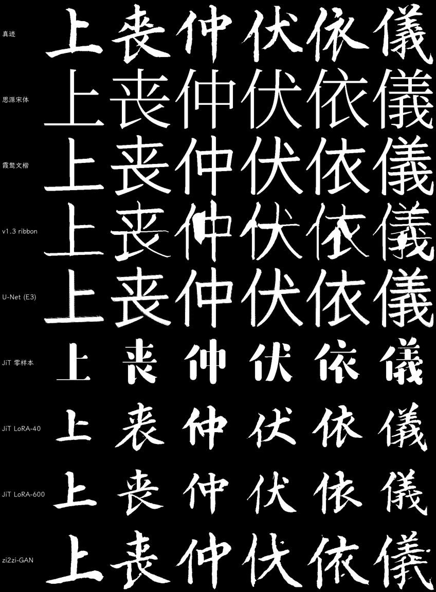
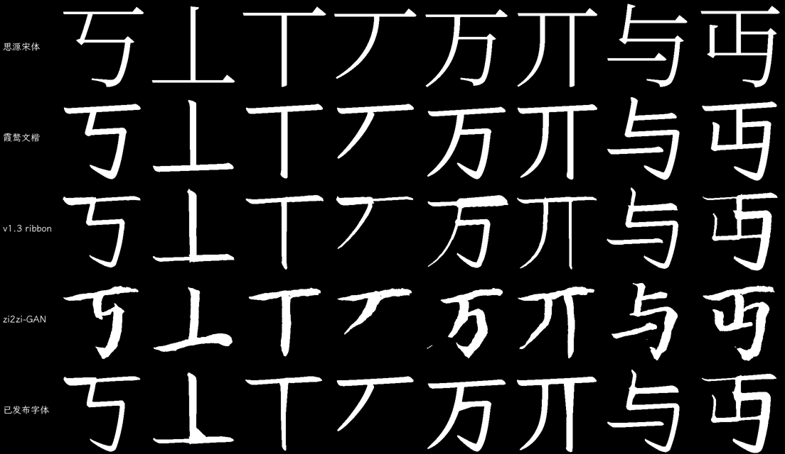

# 合成方案横向评测报告（2026-10-23）

评估集：`work/eval_clean2.json`，取 40 字（GAN 验证集 120 字中、且不在 LoRA 训练集里的 91 字）。
指标脚本：`scripts/23_compare_all.py --set work/eval_clean2.json`，结果写入 `work/eval_all.json`。

## 0. 评估集更正

初版本报告使用 `work/eval_clean.json`，其中 135/142 字在 GAN 与 U-Net 的训练集内，
由此得到的 “GAN Dice 0.594 最佳” 只反映训练集内表现。本版改用两个模型都未见过的 91 字集合
（下称“无泄漏集”）。

## 1. 指标表（120 个留出字，全部对真迹计算，同口径）

留出集 = 模型训练时未见的 120 字（`work/eval_clean3.json`）。JiT 三行的推理结果只覆盖其中 91 字，故 n=91。

| 方案 | Dice | 墨量 | 端帽 cap_mid | 端帽 KS | 笔内 std | n |
|---|---|---|---|---|---|---|
| 真迹 | — | 1.000 | 0.541 | — | — | 120 |
| 思源宋体 | 0.324 | 1.029 | 0.579 | 0.119 | 0.170 | 120 |
| 霞鹜文楷 | 0.431 | 1.187 | 0.607 | 0.143 | 0.124 | 120 |
| **v1.3.2 ribbon** | 0.416 | 1.108 | **0.546** | 0.072 | 0.225 | 120 |
| U-Net (E3) | 0.441 | 1.254 | 0.594 | 0.130 | 0.124 | 120 |
| zi2zi-JiT 零样本 | 0.435 | 0.860 | 0.375 | 0.301 | 0.602 | 91 |
| zi2zi-JiT LoRA-40 | 0.397 | 0.695 | 0.552 | **0.032** | 0.261 | 91 |
| zi2zi-JiT LoRA-600 | 0.387 | 0.669 | 0.546 | 0.034 | 0.259 | 91 |
| **zi2zi-GAN（ep105）** | **0.547** | 0.955 | 0.550 | 0.053 | 0.253 | 120 |

## 1.5 第二个测试集：617 个「只出现一次」的字

`chosen.jsonl` 只收出现 ≥2 次的字（1,675），**617 个只出现一次的字从未参与任何训练**，
是比留出集更严格的外部测试。它们的字身框归一化已按同一流程补齐（`scripts/24_build_singles.py`）。

抽样 120 字的结果（`scripts/25_eval_singles.py`）：

| 方案 | Dice | 墨量 | 端帽 cap_mid | 端帽 KS |
|---|---|---|---|---|
| 真迹 | — | 1.000 | 0.548 | — |
| 霞鹜文楷 | 0.437 | 1.189 | 0.631 | 0.194 |
| **v1.3.2 ribbon** | 0.420 | 1.093 | **0.548** | **0.055** |
| **zi2zi-GAN** | **0.537** | 0.938 | 0.557 | 0.068 |

与 120 字留出集的结论一致（ribbon 0.416/1.108/0.072，GAN 0.547/0.955/0.053），
说明前者的样本选择没有引入偏差。

## 2. 面板 A：有真迹的字



## 3. 面板 B：**没有**真迹的字（真实使用场景）



对 `丂丄丅丆万丌与丏` 这 8 个**不在 1,675 真字里**的字：

| 检查点 | 输出 | 墨量 | 孔洞数一致 |
|---|---|---|---|
| ep17 | 全空（`max=-0.07`） | — | — |
| ep52 | 可生成 | 0.90–1.32 | 6/8 |
| **ep100** | 可生成 | 0.99–1.32 | **6/8**（`丌` 多 1 孔、`丏` 1→2） |

ep17 的全空输出属训练早期状态，ep52 之后消失。ep100 对新字可生成合理字形，
墨量 0.99–1.32，8 个测试字中 6 个孔洞数正确（`丌` 多 1 孔、`丏` 由 1 变 2）。
缺字没有真值，只能做墨量与孔洞的一致性检查。

## 3.5 早期方法复测：是方法失效，还是指标误判？

用同一套指标 + **阈值扫描到等墨量**，复测早期的 U-Net（E3）：

| U-Net 阈值 | Dice | 墨量 | 端帽 KS | 笔内 std |
|---|---|---|---|---|
| 0.30 | 0.467 | 3.06 | 0.458 | 0.521 |
| 0.40 | 0.491 | 1.97 | 0.333 | 0.103 |
| **0.50（当年默认）** | 0.447 | 1.25 | 0.183 | 0.125 |
| 0.60 | 0.301 | 0.51 | — | — |

**结论：等墨量（≈1.0）时 U-Net 的 Dice 只有 0.37 左右，低于 ribbon 的 0.420。**
当年的 0.441 是「墨量 1.25」换来的；它的失效判定成立，甚至比当年认为的更差。

三类误判的性质不同：

| 类型 | 例子 | 说明 |
|---|---|---|
| **假阳性：粗=好** | U-Net 0.441、JiT 零样本 0.528（8 字） | Dice 奖励加粗；等墨量后都掉到 ribbon 以下 |
| **假阴性：漏掉真优点** | LoRA-40/600 | 旧指标只看 Dice，判「无提升」；新指标显示**端帽 KS 0.054 最好**。但 E17 复测证明：把它加粗到等墨量后 KS 劣化到 0.267，这个优点**无法后处理转移** |
| **指标反过来制造失败** | E1/E2 鬼影 | 用 L1 训练，L1 的最优解就是模糊——不是模型不行，是损失函数把模型推向模糊 |

## 4. 结论

1. 目前可无条件用于全量 19,317 字的方案仍是 v1.3.2 ribbon：墨量 1.108、端帽 0.546（真迹 0.541）、
   端帽 KS 0.072、笔内 std 0.225。
2. GAN 在 ep105 的 Dice（0.547）与墨量（0.955）均优于 ribbon，端帽 KS 0.053 也更好，
   但结构仍有 2/8 的孔洞错误，需加闸门后才能进入发布。
3. U-Net 与 JiT 的 Dice 偏高主要来自过粗或过细的墨量，不代表风格更准。
4. v1.3.0 / v1.3.1 实际未使用 ribbon：`10_generate.py` 当时的分发只认 `field`，`ribbon` 落到 brush 分支，
   两个版本的字形是 v1.2.1 的滤波结果。该问题已修（分发改为 `in ("field","ribbon")`），
   并以真正的 ribbon 输出重建为 v1.3.2。

## 5. 面板说明

面板 A 每行 8 个字，均为无泄漏集中有真迹的字；面板 B 的 8 个字不在 1,675 真字内，
用于观察各方案在“没有答案”时的表现（GAN 该行随训练进度改善最快）。

## 6. 复现

```bash
python3 scripts/10_generate.py --method ribbon --workers 12 --out work/generated.jsonl
python3 scripts/11_build_full.py
python3 scripts/23_compare_all.py --n 40 --set work/eval_clean2.json   # 同时生成两个面板
```
> JiT 三行用 `work/eval_zi2zi2.npz`（同一 91 字集）重新推理，故面板 A 含全部 9 种方案。
> 面板 B 自动从 `generated.jsonl` 里挑 8 个「不在 1,675 真字中」的字；GAN 行由当前检查点生成。
